* toc
{:toc}

# 函数连续性

## Weierstrass Function（续）

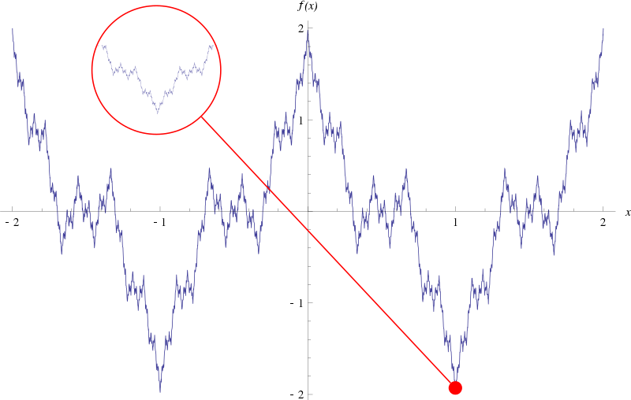

上图是Weierstrass Function图像。它是一类处处连续而处处不可导的实值函数，其表达式为：

$$f(x)=\sum_{n=0} ^\infty a^n \cos(b^n \pi x)$$

其中，$$0<a<1$$，b是奇数，且$$ab > 1+\frac{3}{2} \pi$$。最小的满足该条件的值是$$b=7$$。

一般人会直觉上认为连续的函数必然是近乎可导的。即使不可导，所谓不可导的点也必然只占整体的一小部分。根据Weierstrass在他的论文中所描述，早期的许多数学家，包括高斯，都曾经假定连续函数不可导的部分是有限或可数的。这可能是因为直观上想象一个连续但在不可数个点上不可导的函数是很困难的事。

Weierstrass Function的出现（1872年）说明了所谓的“病态”函数的存在性，改变了当时数学家对连续函数的看法。

Weierstrass Function也被视为第一个分形函数（尽管分形（Fractal）的概念出现的相当晚（1973年），差不多过了整整一个世纪。）：将Weierstrass Function在任一点放大，所得到的局部图都和整体图形相似。因此，无论如何放大，函数图像都不会显得更加光滑，也不存在单调的区间。

参考：

https://wenku.baidu.com/view/21877fea551810a6f524868c.html

一个反例处处连续处处不可导的函数

https://mp.weixin.qq.com/s/ZwrWOZOlSibmM2vlfz1g6g

z = z^2 + c

## 函数连续性和神经网络

理论上说，多层神经网络只要有足够的深度和宽度，就可以任意逼近任意**连续函数**。（严格的说，这里的连续函数必须是Borel可测函数。）

然而从网络训练的角度来说，只有Lipschitz连续的函数才一定会收敛，否则的话，可能会出现梯度爆炸的情况。

此外，不同函数的收敛速度也不一样：

|  | GD | SGD |
|:--:|:--:|:--:|
| Lipschitz | $$\frac{1}{\sqrt{k}}$$ | $$\frac{1}{\sqrt{k}}$$ |
| +smoothness | $$\frac{1}{k}$$ | $$\frac{1}{\sqrt{k}}$$ |
| +strong convexity | $$\frac{1}{k}$$ | $$\frac{1}{k}$$ |
| +smoothness and strong convexity | $$\exp^{-k}$$ | $$\exp^{-k}$$ |

## KAN

Kolmogorov-Arnold representation theorem：

$$f(x) = f(x_1,...,x_n)=\sum_{q=1}^{2n+1}\Phi_q(\sum_{p=1}^n \phi_{q,p}(x_p))$$

KART是另一类函数逼近的方法。

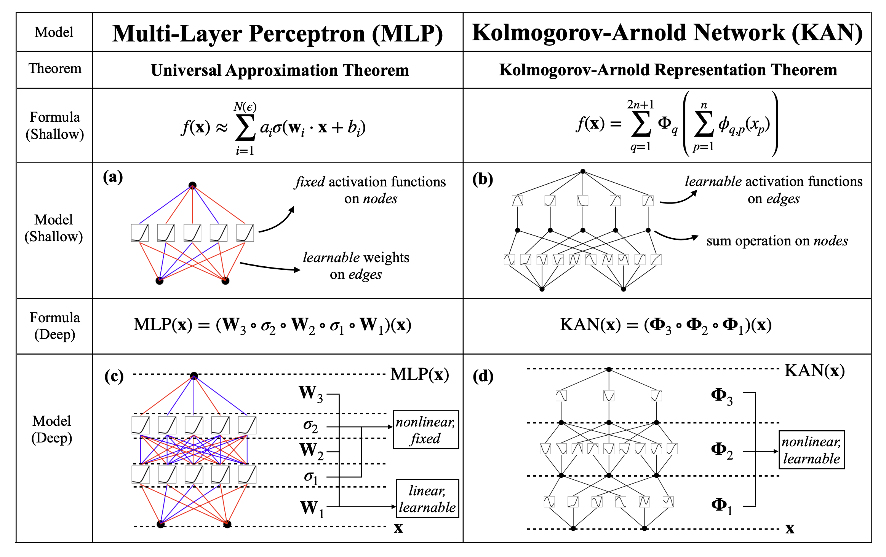

>Vladimir Igorevich Arnold，1937～2010，俄国数学家。莫斯科大学博士（1963），导师Kolmogorov。俄罗斯科学院院士，斯塔克罗夫数学研究所研究员。

https://www.zhihu.com/question/654782153

如何看待新网络架构KAN，它是否能取代MLP？

https://zhuanlan.zhihu.com/p/33570218

阿诺德：从“低能儿”到“奇异数学家”

## 参考

https://www.zhihu.com/question/32201415

函数连续和一致连续有什么区别？开区间上的连续函数不一定是一致连续的，为什么？

http://www.cnblogs.com/flywithyou/p/4135562.html

Lipschitz连续

https://www.zhihu.com/question/62554985

神经网络的上同调理论

http://tech.scichina.com:8082/sciE/CN/abstract/abstract404403.shtml

神经网络的本质逼近阶

http://www.doc88.com/p-2337088655000.html

神经网络的函数逼近理论

https://zhuanlan.zhihu.com/p/25590725

神经网络为什么能够无限逼近任意连续函数？

https://max.book118.com/html/2015/0401/14126427.shtm

浅谈Borel可测函数及其性质

https://mp.weixin.qq.com/s/jrNIhSlTiXsO2sGWmzcFfg

Michael I. Jordan最新清华授课笔记！

https://mp.weixin.qq.com/s/hDRLyOFpLUSW6ZDamwPiAg

相较神经网络，大名鼎鼎的傅里叶变换，为何没有一统函数逼近器？

# 莱洛三角形

定宽曲线（Curve of constant width），或称恒宽曲线，定义：平面上一凸形封闭曲线，不论如何转动，其宽度永远不变，则称之定宽曲线或恒宽曲线。这里所称的“宽度”是指平行线“夹住”某封闭曲线时，平行线间的距离，所谓"夹住"是指每个平行线与凸形封闭曲线相交至少一点且与凸形封闭曲线围起来的内部区域（interior）不相交。

或者可以说，将一个闭合曲线放在两条平行线中间，使之与这两平行线相切，则可以做到：无论这个闭合曲线如何运动，只要它仍与原平行线中的一条直线相切，就必与另一条直线线相切，那么此闭合曲线为定宽曲线。

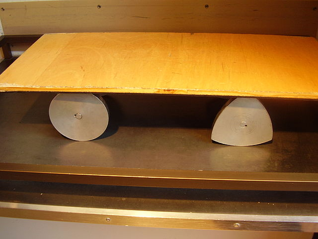

上图是定宽曲线的一个直观的解释。平板下方的两个轮子转动的过程中，平板和桌面的距离保持不变。

这两个轮子一个是圆形，另一个就是本篇的主角——莱洛三角形（Reuleaux triangle）。

>Franz Reuleaux，1829～1905，德国人。这个人可谓是全才。   
>在教育界，当过ETH和柏林工业大学的教授和校长，当然了那个时代这两所学校还不叫现在的名字。   
>在工业界，他发明了300多种机械模型，被誉为动力学（kinematics）之父。
>在政界，他是1876年世界工业博览会德国代表团的主席，参与创立了德国的专利体系。

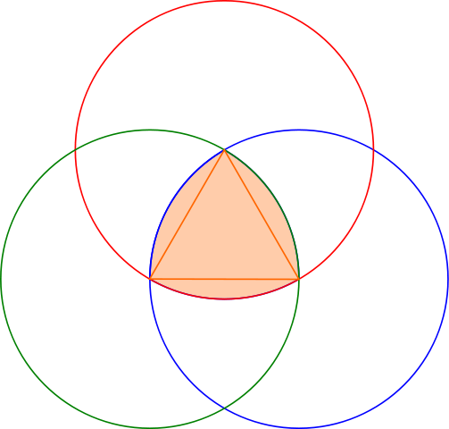

上图是Reuleaux triangle的尺规做图方法。

Reuleaux triangle是“**除了圆形以外，还有什么形状的下水道盖不会掉入下水道？**”这个问题的一个答案。这也是所有定宽曲线的特性。但Reuleaux triangle的特殊之处在于：它是定宽曲线所能构成的面积最小的图形。因此它做的井盖非常省铁。

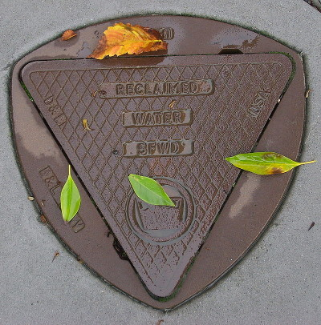

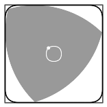

上图展示了零件上的方孔是如何钻出来的。类似的还有：

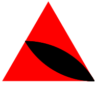

后者叫做delta curves，不过它并不是个定宽曲线。

动力学是一门研究机械以及组成机械的各个部件之间的运动关系的科学，被广泛应用于机械设计领域。比如：

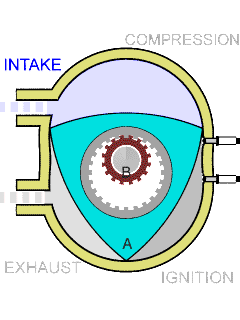

上图是一个没有活塞的发动机气缸，转子的形状就是类Reuleaux triangle的。   

>这里由于汽缸不是方形的，因此只是一个类Reuleaux triangle。

当然，Reuleaux triangle也有它的问题：

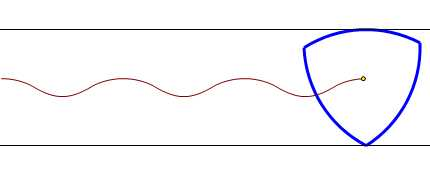

Reuleaux triangle形状的轮子，在上面铺板子跑，当然毫无问题。但如果安装车轴的话，那就蛋碎了...

所以，又有了下面这样的逆问题：

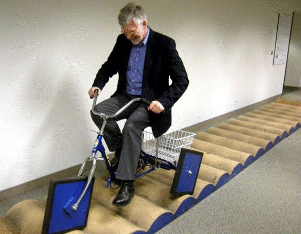

如何让方轮车平稳地行驶呢？只要让波浪轨道符合一段一段的**悬链线**方程。

参考：

https://en.wikipedia.org/wiki/Curve_of_constant_width

https://en.wikipedia.org/wiki/Reuleaux_triangle

https://en.wikipedia.org/wiki/Reuleaux_tetrahedron

http://www.cnblogs.com/hxsyl/archive/2012/07/05/2578448.html

莱洛三角形和定宽曲线

http://twistedsifter.com/2012/11/animated-gifs-that-explain-how-things-work/

20 Animated Gifs that Explain How Things Work

https://mp.weixin.qq.com/s/uUUhQ6tJMrn3J5Ko2u1Hiw

三角形中惊现叛徒！自己胖的像个球，却能成就世界上最快的赛车引擎......

https://mp.weixin.qq.com/s/463KqrYA968HjaBBlsdmow

小伙打造一辆奇葩自行车，走路上百分百的回头率

# hinged dissections

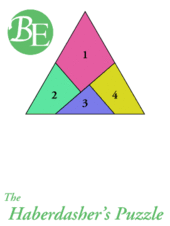

>Henry Ernest Dudeney，1857～1930，英国上世纪最知名的数学科普作家。

# 数学杂谈

李萨如曲线（Lissajous Curve）：两个沿着互相垂直方向的正弦振动合成的轨迹。

https://mp.weixin.qq.com/s/RwG8HaK02-Fa0t26UboD7w

用数学方式打开Facebook新Logo，真的和视频号Logo来自同一方程

---

我曾经给我幼年的儿子测试过。

我问他：5+7等于几？他说不知道。

我又问他：那，7+5等于几？

他还是摇了摇头，正当我觉得儿子数学天赋平平的时候，儿子突然对我说：虽然我不知道7+5和5+7等于几，但我知道7+5一定等于5+7。

我眼睛一亮，顿时对他来了信心，我接着问：为什么会这样呢？

我儿子说：因为整数集对加法构成阿贝尔群。

---

我: 1365/2666和1366/2667哪个更大？

儿子: 当然是后面的更大了。

我: 为什么？你怎么算的？

儿子: 我打了2666场，赢了1365场，现在再打一局，并且赢了，那我的胜率是变高了还是变低了呢？

---

北大就是王虹迄今（学业事业都算上）最低谷的几年，我看她高中同学和法国老师的叙述都说她挺活泼的，但在北大同学的叙述里，她甚至不是很外向。

周睿羊确认，他12岁离开深圳之前水平和邓煜差不多。

https://www.zhihu.com/question/2062972338451362703

王虹、邓煜两位中国数学家首获菲尔兹奖，具有怎样里程碑式的意义？对中国数学意味着什么？

https://www.zhihu.com/answer/2064814153278271757

王虹、邓煜的同班同学谈两人

https://mp.weixin.qq.com/s/TcxRRqob98I7rKT1pXFhKg

成为王虹
