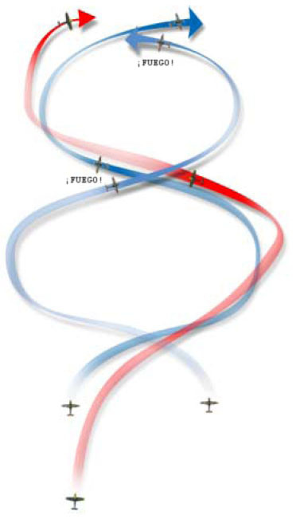
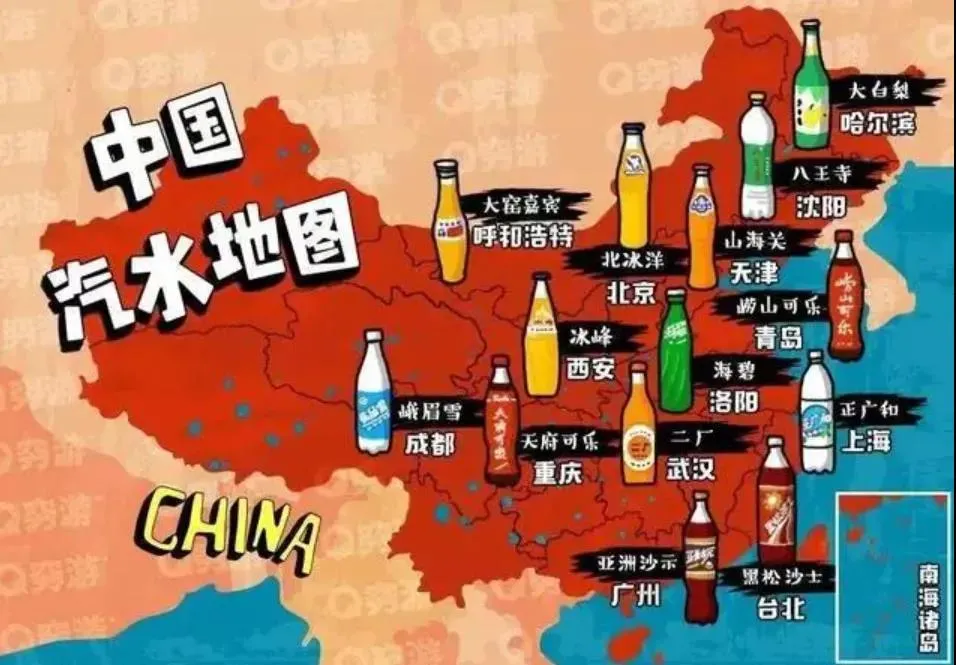
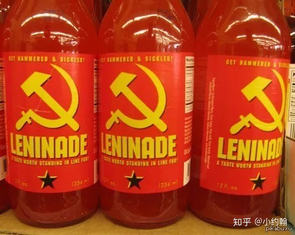

* toc
{:toc}

# 向阳红10号

20世纪60年代，中国在已掌握原子弹制造技术后，决心发展洲际导弹，但这种导弹的射程超过中国陆地国土范围，一旦进行实弹试验，就必须射向远海。而洲际导弹的数据测量与飞行姿态观察，必须出动海上测量船。国防科委向中央军委提出报告，要搞测量船、护航舰艇和后勤补给船只。因为开这个会的时间是1967年1月18日，所以工程也就叫718工程。

向阳红10号，是中国自行设计制造的第一艘万吨级远洋科学考察船。1979年11月由上海江南造船厂建成并交付国家海洋局东海分局使用。曾参加中国首次发射运载火箭、同步通信卫星等重大科研试验任务，1984年11月参加中国首次南极考察队，开赴南大洋、南极洲执行科学考察任务，1988年获国家科技进步特等奖。

但是正因为这船追求一船多用，吨位大，所以也出现了单次使用成本高，而且很多水位相对较浅的海域进不去的问题。对于海洋科考或者测量来说，很多时候三五千吨的测量船反而更合用、使用成本更低。大吨位的向阳红10号，设计理念是很好，但是在实际运用中就比较尴尬。所以最后索性在90年代改装成了远望4号，新增了大量测控设备，专用于航天测控。

2007年8月5日凌晨5点10分，远望4号在江阴基地靠泊时，被“港海666”号万吨级运煤货轮碰撞，碰撞点在4号船艏油舱部位并引发大火，大火在4小时后扑灭，但船上监测仪器已严重受损，没有人员伤亡。随后该船送往江阴船厂维修。

国务院非常重视这次事故，要求有关部门严查原因。负全责的港海666当时立即被军方的两艘小炮艇控制，船长等主要驾驶人员被带走问讯。国安局及总部将此事故一开始定位是恐怖袭击，事发后总装将军云集江阴市，后搞清是港海666上驾驶人员在江阴段避让横穿航道小船时，叫左舵因江流冲击无法回舵后船员想继续左舵转向下行（想180度调头），但此时港海666船艉受水流作用回旋余地不够，导致港海666几乎迎头碰上在岸边停泊的远望4号，并与远望1号轻微碰擦。

2011年，作为DF-21D靶船的远望四号被东风21d打击后拖带过程中出现下沉，随后拖至浅水区搁浅。天津一拆船厂花几千万买回拆解。

同年，国家海洋局批准新建科考船“向阳红10号”，2014年3月28日入列国家海洋调查船队。

---

远望得名于叶剑英所创、毛泽东手书的七律诗《远望》，船体上的字也是真迹而来。

远望号航天测量船几乎伴随着我国航天起步，最早的一艘为远望1号，早在1977年就顺利下水入列，而最新的远望7号在2016年下水入列，排水量已经接近半个辽宁号了，非常惊人的尺寸。

文昌发射火箭最重要的一环，海上运输，就由2013年刚投入使用的火箭运输船远望21和22号完成。由于是完全不同功能的运输船，它们的编号自然不应沿用1到7的传统编号，而是从20系列重新开编。

https://zhuanlan.zhihu.com/p/87245498

最近我们为啥总是关注远望21/22两艘船？

# 秦淮八艳

柳如是 钱谦益

陈圆圆 吴三桂

李香君 侯方域

董小宛 冒辟疆

顾眉生 龚鼎孳

卞玉京 吴伟业

寇白门 朱国弼

马湘兰 王穉登

---

钱谦益：水太凉。

龚鼎孳：我本欲殉国，奈小妾不允。

# Thach Weave

“萨奇剪”战术：当一对美国海军战斗机被敌军一架更具机动性的战机攻击时，那架被攻击的飞机便成为了“鱼饵”，而他的僚机便成为了“鱼钩”。鱼钩和鱼饵会向靠近对方的方向转动，这时路径出现交叉。然后当他们在分叉航线上飞得足够远时，他们又会再次执行交叉航线。一旦次方案成功实施，鱼饵将会在鱼钩的机鼻前通过，同时敌机会在鱼饵的机尾后。这样会给鱼钩获得一个射击窗口并一击致命。

在珊瑚海“萨奇剪”初试牛刀后，还是在使用野猫的美国，对日的战机交换比从之前的6:1追平到约等于1：1。在战法全面普及后，瓜岛的仙人掌航空队已经能吊打零战。等43年，专门针对零战的地狱猫全面装备后，零战已彻底沦为火鸡，日本彻底丧失制空权。

https://www.zhihu.com/answer/2061556773505479923

拉包尔空战

---

眼镜蛇机动是著名的过失速机动动作，是由前苏联的Su-27战斗机首先试飞成功的。1989年6月在巴黎航展上，前苏联著名试飞员维克多尔·普加乔夫第一次在全世界面前表演了眼镜蛇机动，震惊全场，因此这一机动动作又被称为“普加乔夫眼镜蛇”机动。

# 汽水

北冰洋——北京

山海关——天津

正广和——上海

亚洲沙示——广东

宏宝莱汽水——吉林

大连汽水——辽宁大连

八王寺汽水——辽宁沈阳

大白梨汽水——黑龙江哈尔滨

冰峰——陕西西安

维尔康汽水——山西阳泉

太钢汽水——山西太原

沧冷汽水——河北沧州

海碧汽水——河南洛阳

咸伙计——湖北武汉

二厂汽水——湖北武汉

天府可乐——重庆

峨眉雪——四川乐山

大窑嘉宾——内蒙古呼和浩特

亚洲之星——新疆

https://new.qq.com/omn/20200701/20200701A0BFZW00.html

从北冰洋到正广和，全国各省人的本命汽水了解一下？

https://mp.weixin.qq.com/s/eftqeqQtUA3D6AdtmJjcbg

夏天的明媚，都是汽水给的

https://zhuanlan.zhihu.com/p/699556655

2024年最惨国货：没有星巴克的命，得了星巴克的病！（汉口二厂）

https://zhuanlan.zhihu.com/p/259191586

苏联时期的骄傲“苏联冰淇淋”以及你想要知道的一切

https://zhuanlan.zhihu.com/p/60363901

忆五十年代我国的罐头生产和出口

https://zhuanlan.zhihu.com/p/210478662

夏天的难忘滋味：格瓦斯是什么样子的？

https://zhuanlan.zhihu.com/p/219688003

在苏联的汽水里有什么特别的，为什么它们看起来如此美味？

https://zhuanlan.zhihu.com/p/263518388

苏联罐头食品与苏联百姓的日常饮食

https://zhuanlan.zhihu.com/p/80353165

苏联衣食住行

https://mp.weixin.qq.com/s/ztPg8Z2_eotvOW5F7MmbHg

乘风破浪的中国葡萄酒，藏着怎样的时代风华

https://mp.weixin.qq.com/s/zbGBNa8ifHljBsuv04VN_w

你还能“雪糕自由”吗？

https://www.zhihu.com/answer/2720473635

已然遥远的红色国度所留下的甜蜜：苏联的糖果与巧克力

---

尽管100多年前，在北京的街头和法国的租界中，就出现了俄国人开设的酸奶铺，但中国人真正开始现代化批量发酵和销售酸奶，始于20世纪80年代。现在被称为“老酸奶”的装在陶瓷瓶中的凝固型酸奶，是国人对于酸奶的最初记忆。

https://mp.weixin.qq.com/s/lpbgzNlTw8xGqDmB9aweZw

舌尖的甜蜜记忆：酸奶中的中国故事

---

美军五星上将艾森豪威尔是可口可乐的忠实粉丝，据说朱可夫元帅第一次品尝可口可乐就是他推荐的。朱可夫第一次喝可乐还闹了笑话，他像喝伏特加那样大口豪饮，结果气泡狠狠地刺激了一把他的鼻腔，见此情景的艾森豪威尔笑得合不拢嘴。从此，朱可夫元帅对可乐上了瘾。

可是，这瓶小小的可乐让这位功勋卓著的统帅犯了难。在东西方对抗的冷战时期，苏联禁止销售这种产自美国的饮料。他明白自己身为苏军高级将领是万万不能公开饮用这种象征着资本主义的饮料，只好私下通过隐秘的渠道获得可口可乐，同时要求换掉那种“可笑”的外包装以及去掉其特有的颜色。

1946年，驻奥地利美军司令马克·克拉克将军得知此事，向可口可乐公司提出制作透明可口的请求。

最终，可口可乐布鲁塞尔分公司按照要求制作出了“白可乐”。这种白可乐不含焦糖色素，装入直筒瓶里（不同以往的曲线瓶）。此外，瓶盖上了还用一颗红星来装饰，看起来很像小瓶伏特加，具有很强的伪装性。

---

1989年，苏联和百事公司的合作协议到期，两国就新的合作协议进行谈判。由于苏联无力支付足够的伏特加，也没有多余的外汇去购买，可以说苏联除了武器装备什么都没有，所以苏联人想出了用军舰换可乐的办法。就这样，百事可乐从苏联人手中得到了1艘巡洋舰（1.3万吨）、1艘护卫舰、1艘驱逐舰、17艘潜艇以及数艘油轮。百事可乐一跃成为世界第六大海军力量，成为当时世界上最大的私人海军。

不过百事公司对这些军舰根本不感兴趣，他们把军舰拖到瑞典全拆了。肯德尔曾和老布什政府的国家安全顾问布伦特·斯考克罗夫开玩笑：“我们正在比你们更快地解除苏联人的武装。”

列宁牌苏打水

https://zhuanlan.zhihu.com/p/59898479

冷战硬通货——百事曾经用可乐换苏联军舰？！

https://zhuanlan.zhihu.com/p/408538594

苏联人有多喜欢可乐，没钱买可乐，直接拿舰队换可乐

---

可乐味汽水当年什么万事可乐，成龙做广告的汾煌可乐，娃哈哈非常可乐，很多很多……崂山可乐一直卖到现在。

---

现在著名的哈尔滨啤酒厂是俄国人创立的，起初名叫乌卢布列夫斯基啤酒厂，这也是中国第一家啤酒厂。

“正广和”解放前是可口可乐第一大罐装厂，当时全国第一大汽水厂。

https://www.zhihu.com/question/20402388

为什么盐汽水只在江浙沪地区流行，其它地区很少有人喝呢？
