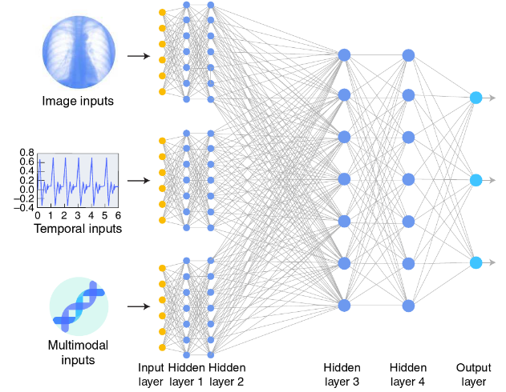
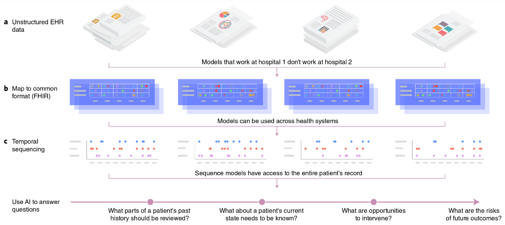
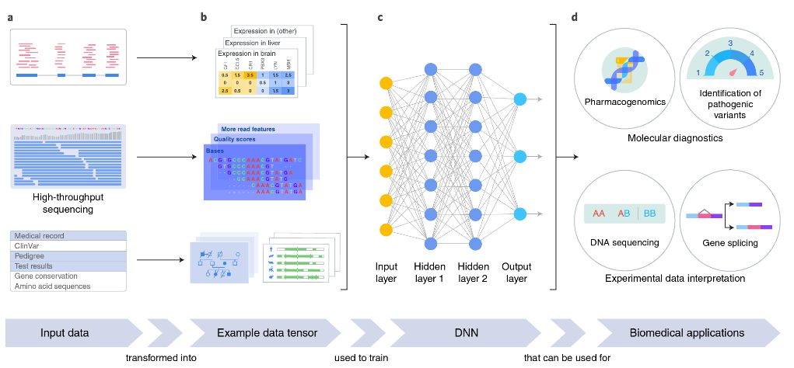

* toc
{:toc}

# AI医疗

https://github.com/albarqouni/Deep-Learning-for-Medical-Applications

基于深度学习的医疗影像论文汇总

https://mp.weixin.qq.com/s/vtJUM94oYpN_h3Sdg3exLQ

张益肇：AI+医疗，微软有哪些布局？

https://mp.weixin.qq.com/s/mkYVhiwQJwcXxUdBVUvU8w

体素科技丁晓伟：医疗影像的哲学三问

https://mp.weixin.qq.com/s/aGc8Y8I_Xt0837H0MUVL-g

CMU副教授马坚：精准基因组数据和智能医疗最新进展

https://mp.weixin.qq.com/s/1E9gunSpgYt5xl9Q_uQNJg

使用深度学习进行医疗影像分析：文件格式篇

https://mp.weixin.qq.com/s/uy3MNxyT5nQIVsfWkXnL5Q

结合生成式与判别式方法，Petuum新研究助力医疗诊断

https://mp.weixin.qq.com/s/1A6p672z4Yz__MF6TWORSw

备战医疗大赛必看！

https://mp.weixin.qq.com/s/DuFvVmcyazyUYxyoekh38w

邓侃解读：深度学习病历分析前沿进展

https://mp.weixin.qq.com/s/QB5d6HwAcT7DiVQbmoD8qg

AI研发新药真有那么神？可能哈佛、斯坦福和阿斯利康实验室都在吹牛

>医药方面的AI应用，也是AI的一个潜在的应用领域。这篇文章敢把各个大学鄙视一番，还是有些干货的。

https://mp.weixin.qq.com/s/ZMw12BJuexG0xM8OwWUc4w

谷歌《Cell》论文：使用深度学习，直接对细胞影像生成荧光标记

https://mp.weixin.qq.com/s/OkZdmBvSeMEsZbJyoZQvBQ

深度学习+基因组学：破译人类30亿碱基对

https://mp.weixin.qq.com/s/RBBdPLvSYy5Ss4mOU-in4Q

用深度学习方法修复医学图像数据集

https://mp.weixin.qq.com/s/aSCTrmfYEE7Dc1uPkg0fZg

百度提出NCRF：深度学习癌症图像检测效率再提升

https://mp.weixin.qq.com/s/fqHTGcmTZ91lXbhcrUQNcg

弱监督学习在医学影像中的探索

https://mp.weixin.qq.com/s/aRipNkT2BSc5NefB9k4rEA

Nature Medicine论文展示DeepMind眼疾诊断里程碑：临床专家级、“解决“黑箱问题

https://mp.weixin.qq.com/s/NyRiLMDDADoOsa1Os9xcMw

Neuromation新研究：利用卷积神经网络进行儿童骨龄评估

https://mp.weixin.qq.com/s/0IAdT2cP_OIGwwXmMaCFfw

如何利用深度学习诊断心脏病？

https://mp.weixin.qq.com/s/YgH6iiKPZ-FCflikAqAakw

点内科技、华东医院及上海交大合著论文：3D深度学习在CT影像预测早期肿瘤浸润方面超过影像专家

https://mp.weixin.qq.com/s/q8iljb3GPgmdJUeF9kMvlA

AI进军新药发现研究？这99页slides了解一下

https://mp.weixin.qq.com/s?__biz=MzU2OTA0NzE2NA==&mid=2247500351&idx=1&sn=f7280dd8e62a535cd3b8e82fd20e2eda

128页多媒体计算在医学领域的重要性教程

https://mp.weixin.qq.com/s/MSjtlwC2L3yAmQc_VBBPiQ

同济大学综述论文：基于深度生成模型的药物研发

https://mp.weixin.qq.com/s/bHaXO2G-3B_KnyVGc-2hEg

新开源计算机视觉技术用于新生儿胎龄估计

https://mp.weixin.qq.com/s/H5bnFRSxmwHSdNBPdbsh3w

Petuum新研究助力临床决策：使用深度学习预测出院用药

https://mp.weixin.qq.com/s/z-_CxTQup-g6cAvVDwS-kQ

谷歌开源DeepVariant，之前的经典检测基因变异法将被颠覆

https://mp.weixin.qq.com/s/ojlhC7vGB1r6scKipm0BjA

小样本如何进行深度学习？西北工夏勇教授这一份54页《医学影像小数据深度学习》PPT为你讲解

https://mp.weixin.qq.com/s/ggZZpBPap398yQ1asHD7aQ

深度重建：基于深度学习的图像重建

https://mp.weixin.qq.com/s/uIMJybw4fSxeCPeBTGTA-g

借鉴传染病学原理探索医学图像CNN可解释性

https://mp.weixin.qq.com/s/oNcGYuGwkllINZhvrL6uvQ

体素科技：2018年，算法驱动下的医学影像分析进展

https://mp.weixin.qq.com/s/c1j60gOWh99z-BXWs9qAwQ

Jeff Dean等发文《Nature Medicine》，综述深度学习在医疗领域的应用

https://mp.weixin.qq.com/s/bwcEzq8v72dgak6IUunagw

医学图像分析最新综述：走向深度

https://mp.weixin.qq.com/s/hZp6W4nVuUxe_91nhDi6lw

使用Nucleus与TensorFlow进行DNA测序纠错

https://mp.weixin.qq.com/s/T5ef2rELB3z3vHbVmqgkaw

基于深度学习的生物信息学应用及展望

https://mp.weixin.qq.com/s/kIuUe0Rzcpdm7Sowpe7Tjw

医疗机器学习综述，谷歌Jeff Dean等最新论文

https://mp.weixin.qq.com/s/H-Bm2u6Ld-9QfdHbZDZ4cw

关于GANs在医学图像领域应用的总结

https://mp.weixin.qq.com/s/qhqnAoWa81cdeTY5ywZnnw

医学图像处理与深度学习入门

https://mp.weixin.qq.com/s/Sb0KOr5RVallKevlX0m-SA

医学图像分割（一）——脑区域分割

https://mp.weixin.qq.com/s/b8Cvy5X9jP11biRGm005ow

医学图像分割（二）——心脏分割

https://mp.weixin.qq.com/s/45JOopEwHoNtzF57SxZM1A

医学图像分割（三）——肿瘤分割

https://mp.weixin.qq.com/s/L1c30sTN1CSth_KdORzpVw

用于医学图像分割的主动轮廓线学习模型

https://mp.weixin.qq.com/s/Uh0EI-pTaXK46Zb08_cs0g

智能医疗综述，48页论文详述医学AI最新进展

https://mp.weixin.qq.com/s/9dcq4rTcSvo5kQJ3GjwdTg

医学图像分割专栏之前列腺分割

https://mp.weixin.qq.com/s/UHlY_-mYBLT383TP6Y7Oew

生物数据挖掘中的深度学习综述论文，36页pdf

https://mp.weixin.qq.com/s/w_5-3ViQyBpRVyVe0sHFLw

深度学习生命科学：基因组学、药物发现，238页pdf

https://mp.weixin.qq.com/s/5MbMdMhMvPLCEu32r5l59Q

MedMNIST：上海交大发布医学影像领域的MNIST

https://mp.weixin.qq.com/s/clPpAveascHt7xwPr83HvA

Pair，医学图像标注神器

# 数据结构 & 普通CS算法+

https://mp.weixin.qq.com/s/8gDVqlywLBl-MZa6XrtXug

为什么磁盘存储引擎用b+树来作为索引结构？

https://mp.weixin.qq.com/s/M5syxE9Ln4UDLThPh5iuJg

各种字符串Hash函数比较

https://blog.csdn.net/wo541075754/article/details/54632929

Merkle Tree（默克尔树）算法解析（Merkle Tree，通常也被称作Hash Tree，顾名思义，就是存储hash值的一棵树。）

https://mp.weixin.qq.com/s/M8U9B7UA2AdfnJi5EpTv-g

算法面试中经常问的“字符串”问题

https://mp.weixin.qq.com/s/QHounf4el7nmXnpMSJHjvg

这个问题不简单：寻找缺失元素

https://blog.csdn.net/changtao381/article/details/8936765

Splay Tree（一种二叉排序树）

https://mp.weixin.qq.com/s/p4tddWB4kjFufkv3x2SYpw

图解6种树，你心中有数吗

https://mp.weixin.qq.com/s/fAYjIcFlHoXK2E38JJSFpA

C++优先队列priority_queue

https://mp.weixin.qq.com/s/KZq5SjPESQnQaNU1Mn5a-A

一文把三个经典求和问题吃的透透滴

https://www.zhihu.com/question/20298134

即时战略游戏中实用的寻路算法都有哪些，比较如何？

http://blog.codinglabs.org/articles/algorithms-for-cardinality-estimation-part-i.html

解读Cardinality Estimation算法

https://mp.weixin.qq.com/s/zQJve_w5OoM6u-WcSWArdQ

神速Hash

https://www.codeproject.com/Articles/69941/Best-Square-Root-Method-Algorithm-Function-Precisi

Best Square Root Method

https://zhuanlan.zhihu.com/p/332996578

陈丹琦分治算法

https://utopia1991.github.io/2019/01/14/fisher/

Fisher–Yates shuffle洗牌算法

https://zhuanlan.zhihu.com/p/717126119

一个让人惊艳的算法——CORDIC算法介绍

https://www.zhihu.com/question/59592797

计算机语言中是如何处理sin函数的？

https://www.zhihu.com/question/52968810

有哪些复杂度为O(1)的神奇算法？

# 电子科技史+

当年NTS-2卫星发射时（1977年6月23日），它搭载着第一台被送入轨道的铯原子钟，当时人们其实还不是非常确定是否真的需要相对论效应。于是卫星时钟系统中内置了一个频率合成器，以便在发射后，如果原子钟在其最终轨道上的速率确实符合广义相对论的预测，那么就可以启动合成器，使原子钟达到运行所需的速率。NTS-2上的铯钟启动后，在启动合成器之前，它运行了大约20天，以测量其时钟速率，结果完全符合GR的预测，于是频率修正启动！

https://www.zhihu.com/answer/1913569281196663455

GPS的相对论修正

---

当年的磁芯内存，断电之后数据根本不会丢。

在1965年的机房里，你写了一段程序跑在内存里，这时候保洁大妈一不小心把大型机的电源插头给踢掉了，机器瞬间黑屏。你把插头重新插回去，通上电，刚才算到一半的数据还在磁芯内存里老老实实呆着呢，机器接着刚才的进度继续往下算。

那个年代的内存，既是内部存储器，又是永久存储器。根本不存在什么临时存储的概念。
