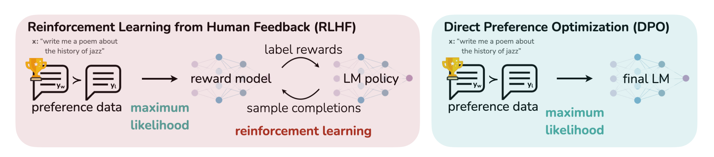
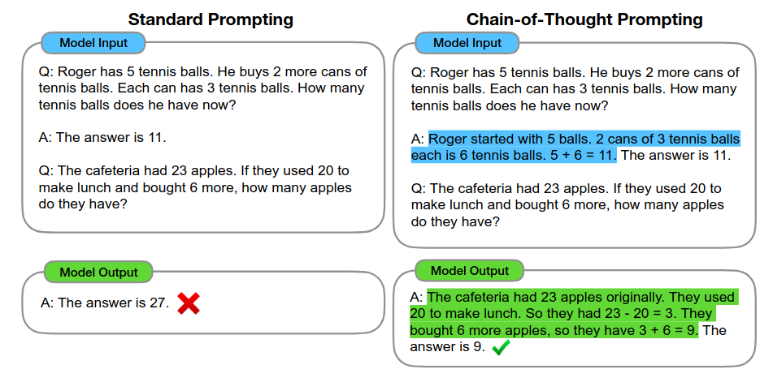
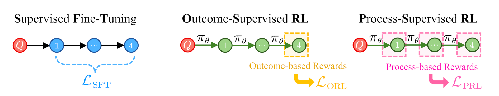
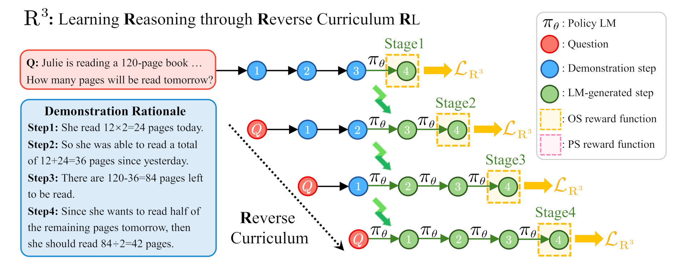
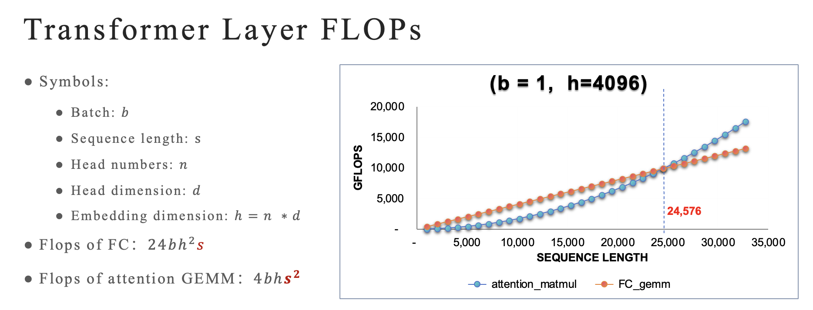

* toc
{:toc}

# RLHF（续）

Rollout Routing Replay（R3）

现代RL训练框架要用两个引擎：一个inference引擎跑rollout，一个training引擎跑反向传播。Dense模型这两个引擎产生的token概率分布很接近，KL散度小到可以忽略。但MoE多了一层路由器——inference阶段选中的几个专家、和training阶段被选的几个专家可能根本对不上号。同一个token在两个引擎里走的就不是同一条计算路径。

这种漂移在短训练里看不出来，一旦放到长trajectory的RL训练里，KL散度会一路飙到把训练流程直接撕开。论文里给的数字：MoE模型的训练-推理KL散度是$$1.5×10^{-3}$$，稠密模型只有$$6.4×10^{-4}$$。R3的解法很简单粗暴：把inference阶段算出来的路由mask直接缓存下来，training阶段强制重放——确保两个引擎选到完全一样的专家。

---

参考：

https://zhuanlan.zhihu.com/p/592671478

ChatGPT背后的算法——RLHF

https://zhuanlan.zhihu.com/p/612572103

RLHF的其他优化方向

https://zhuanlan.zhihu.com/p/608176805

如何看懂ChatGPT里的RLHF公式以及相关实现

https://zhuanlan.zhihu.com/p/644680366

LLaMA2 RLHF技术细节

https://zhuanlan.zhihu.com/p/645068532

大模型RLHF的trick

https://zhuanlan.zhihu.com/p/635569455

RLHF实践

https://zhuanlan.zhihu.com/p/667152180

一些RLHF的平替汇总（2023.11）

https://zhuanlan.zhihu.com/p/621456865

DeepSpeed-Chat开源了

https://brightliao.com/2023/05/25/chatgpt-rlhf/

ChatGPT的自动优化

https://www.zhihu.com/question/651021172

为什么需要RLHF？SFT不够吗？

https://blog.csdn.net/v_JULY_v/article/details/132939877

从零实现带RLHF的类ChatGPT：逐行解析微软DeepSpeed Chat的源码

https://blog.csdn.net/sinat_37574187/article/details/138200789

图解大模型RLHF系列之：人人都能看懂的PPO原理与源码解读

https://blog.csdn.net/v_JULY_v/article/details/128579457

ChatGPT技术原理解析：从RL之PPO算法、RLHF到GPT4、instructGPT

https://blog.csdn.net/v_JULY_v/article/details/129996493

详解带RLHF的类ChatGPT：从TRL、ChatLLaMA到ColossalChat、DSC

## DPO

Direct Preference Optimization是一类不训练reward model而直接更新LM的方法。

对于同一个propmt，给定一个好的回答和一个不好的回答，通过降低不好回答被采样的概率，提升好回答的概率，从而进行模型训练。

---

Token-level Direct Preference Optimization（TDPO）

Monolithic Preference Optimization without Reference Model（ORPO）

---

https://blog.csdn.net/v_JULY_v/article/details/134242910

RLHF的替代之DPO原理解析：从RLHF、Claude的RAILF到DPO、Zephyr

## Chain-of-Thought

思维链就是一系列中间的推理步骤(a series of intermediate reasoning steps)。通过让大模型逐步参与将一个复杂问题分解为一步一步的子问题，并依次进行求解的过程可以显著提升大模型的性能。

OpenAI o1 = COT + RL

每一轮推导，都把推导结果作为输入塞给下一轮作为输入，如此反复，相当于用一张巨大的草稿纸记录做题过程，每次演算都把推导过程写在草稿纸上，这样下次演算可以参考之前的演算过程，这样重复演算多次，每次演算的角度可以不一样，最终结果就非常综合而且全面，草稿纸越大，能写的演算过程越多，应对一些刁钻复杂问题，也就更容易得出准确答案。

CoT模型增加了推理过程，期望利用**inference time scaling**来解决问题并提高准确率。这进一步导致了context长度的增加。

短序列时代，Attn后面的FFN占用了80%的计算量，然而**到了LLM时代，Attn开始占据计算量的大头**。（Attn的复杂度是$$O(n^2d)$$, n为序列长度，d为hidden size）。

---

COT+RL主要有以下四条路线：

- 基于过程监督的强化学习。代表作：OpenAI的Let's verify step by step、过程奖励模型（Process Reward Model，简称PRM）。这个路线所面临的核心问题是：怎么去界定步骤？谁来判定哪个过程是正确的？

- 蒙特卡洛树搜索（MCTS）。代表作：微软的rStar。

- 监督微调。既然原先大模型在预训练的时候要预测下一个字符是什么，那么我们收集一堆思维过程给大模型，让它们照葫芦画瓢，没准就有用呢？这个路线所面临的核心问题是：并没有那么多思维过程数据能给到大模型。几乎所有的教科书、教辅书都只会把正确过程给印到答案上，而不会把错误的过程给印上去。代表作：DeepSeek-R1蒸馏出来的那些Qwen和Llama小模型。

- 基于规则的强化学习。在过程监督以及MCTS两种方法中，都会面临怎么去对过程进行拆分、怎么去对过程中的某一步（正确性或者未来预期的正确性）进行打分的问题。有人感到这件事实在是过于困难了。所以，他们打算只看结果，不看过程，让模型自由发挥。代表作：OpenAI的o系列、DeepSeek-R1、Kimi-k1.5。

---

传统CoT依赖模型内部知识易产生幻觉；传统RAG无法动态调整检索内容，难以应对多跳/多步推理（如HotpotQA等多跳问答任务）。

Interleaved Chain of Thought：将外部知识检索（Retrieval）与思维链推理（CoT）交替进行、相互引导，而非传统的"先检索后推理"单步模式。

工作流程：

- 用当前推理步骤生成精准的检索查询。
- 用新检索到的知识修正/推进下一轮推理。
- 循环迭代直到得出最终答案。

---

https://blog.csdn.net/Julialove102123/article/details/135499567

一文读懂Chain of Thought，CoT思维链

https://zhuanlan.zhihu.com/p/721952915

Reverse-o1:OpenAI o1原理逆向工程图解

https://blog.csdn.net/v_JULY_v/article/details/142865592

一文通透OpenAI o1：从CoT、Quiet-STaR、Self-Correct、Self-play RL、MCTS等技术细节到工程复现

https://zhuanlan.zhihu.com/p/19969128139

MCTS树搜索会是复刻OpenAI O1/O3的有效方法吗

https://blog.csdn.net/v_JULY_v/article/details/145289228

一文速览火爆全球的推理模型DeepSeek R1：如何通过纯RL训练以比肩甚至超越OpenAI o1(含Kimi K1.5的解读)

https://zhuanlan.zhihu.com/p/20538667476

三张图速通DeepSeek-R1论文和技术原理

## MemKK

Knights and Knaves (K&K) (Johnson-Laird & Byrne, 1990)是一个用于逻辑推理的数据集。

它在形式上表现为几个人在对话，对话内容有真有假。需要通过推理分析出哪些内容为真，哪些为假。

数据集以参与对话的人数的不同，分为若干子集。例如8ppl表示有8个人参与对话，显然人数越多，分析的难度越大。

官网：

https://memkklogic.github.io/

参考：

https://zhuanlan.zhihu.com/p/27699656438

用极小模型复现R1思维链的失败感悟

## Constitutional AI

奖励在RL中起着至关重要的作用，指导着优化过程。在可以通过外部工具进行验证的领域，如某些编码或数学场景中，RL显示出了出色的效果。然而，在更一般的场景中，通过硬编码构建反馈机制是不切实际的。

Constitutional AI是一种由Anthropic公司提出的理念和技术方法。简单来说就是，不是所有打标都要人搞，比如有害性标注就可以交给模型负责，然后我们可以在降低有害性，提高有用性两个维度上，做帕累托改进。

## TRL

TRL是huggingface的库，用于微调和调整大型语言模型，包括Transformer语言和扩散模型。这个库支持多种方法，如监督微调（Supervised Fine-tuning, SFT）、奖励建模（Reward Modeling, RM）、邻近策略优化（Proximal Policy Optimization, PPO）以及直接偏好优化（Direct Preference Optimization, DPO）。

代码：

https://github.com/huggingface/trl

参考：

https://zhuanlan.zhihu.com/p/693304721

RLHF：TRL - Transformers Reinforcement Learning使用教程

## 杂谈

OpenAI在2022年3月发表的InstructGPT论文里，确立了标准的基于人类反馈的强化学习流程，也就是雇佣大批外包标注员，让每个人花几分钟看两条模型回答，挑出看着更顺眼的一条来训练奖励模型。这套办法在早期见效极快，但随着模型能力变强，外包人工打分的弊端就开始反噬模型。外包标注员在几十秒内根本来不及逐行验算三百行代码能不能跑通，也没法核对深层逻辑，往往看谁分段整齐、加粗小标题多、开头先顺着用户的话夸一句，就给谁打高分。

这种外包打分机制直接把早期的GPT训出了两个让开发者非常头疼的毛病。

第一个毛病是迎合与打官腔。Anthropic在2023年10月专门发过一篇研究大模型谄媚现象的论文，实测了五个由人类偏好数据训出来的奖励模型，发现只要用户在提问里夹带一点错误暗示，模型为了迎合人类标注员的偏好，就会大概率顺着用户的错话往下编，哪怕它原本在预训练阶段知道正确答案。

第二个毛病是写代码偷懒。在人类偏好打分体系下，模型老老实实写完三百行完整代码，不仅耗时耗算力，而且写得越长越容易在某个细节上被标注员挑刺扣分；反而是先列个一二三四的大纲，写二十行框架代码，中间最麻烦的业务逻辑留一句注释让用户自己补全，既不容易出错又能拿到高分。从GPT-4 Turbo时代开始，无数程序员被这种只给框架不给实现的省略号代码折磨得苦不堪言。

https://www.zhihu.com/answer/2101636862989420276

为什么GPT先起飞，Claude现在却断档领先？他们有独特的训练方法吗？
