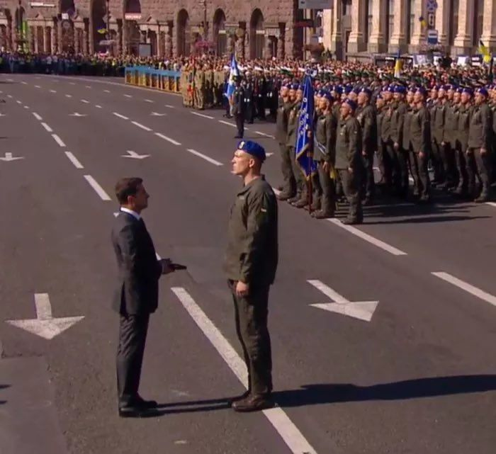
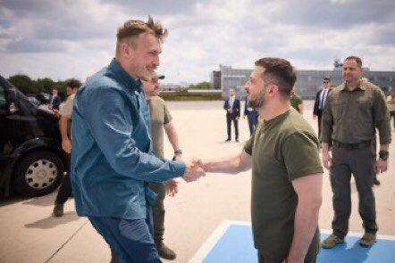
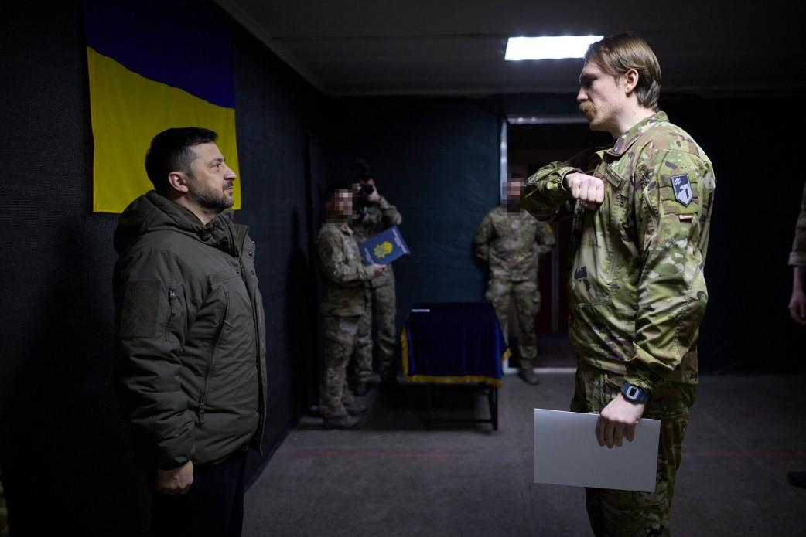

* toc
{:toc}

# 俄乌战争：疾风篇

## 泽连斯基（续）

亚速营的Denys Prokopenko中校，指挥了著名的亚速钢铁厂保卫战。

2019年，独立日庆典上，泽连斯基给普罗科彭科授勋，后者拒绝敬礼，引起争议。

2023年，赶紧叫爸爸。。。

把人从包围圈救出来，没有弃之不顾，一年来的超预期表现，没有妥协。普罗科彭科点头弯腰是正常的，这是真服了。

战前戏子既没权力，也没威望，大家就是不服他。当然基辅不跑后一切都变了。戏子以中立偏亲俄的面孔上来，乌东部人，还常年混迹于莫斯科，上来就高喊对话妥协，大家把他认为毛子间谍都正常。只不过大弟也瞧不起他，对他的对话请求根本置之不理。

战争已经以最无情的方式检验了乌克兰人的领袖，证明他是一个真正的统帅，这种鉴别，远比任何方式都更加有效，也更加公正和有说服力。

2026年的Prokopenko准将

---

瓦夏上个月接受采访时表示，去年不止一个国家不止一次表示，愿意负责照顾瓦夏十岁的儿子凯里洛，并保证会把他送去最好的学校读书。瓦夏拒绝了。

按照他的说法，别人的儿子正在前线流血，总统的儿子却在国外沙滩上晒太阳，是不合适的。

---

泽连斯基证明了反抗是可能的，胜利是有望的。那么一直以来将大帝奉为神明的人的驯服就是不必要的，毫无价值的。

---

当加拿大总理特鲁多向泽连斯基介绍一位坐在轮椅上的二战老兵（99岁的Melvin Hurwitz）的时候，老兵握着泽连斯基的手，突然要亲吻他的手。

泽连斯基反应极快，连忙说“使不得，使不得”，马上蹲下来，搂住了老兵。

西方吻手礼是信徒对牧师、平民对贵族、卑对尊的礼节，所以Zelensky这里有个明显的收手的动作，而那个拥抱则是儿子对父亲的礼节。

MH: Oh, you’re the savior of the people, you bring tears to my eyes.

Zelensky: No no, you saved Europe.

MH: My hero.

Zelensky: No, you are our hero.

MH: I pray for you.

Zelensky: Thank you so much.

据美国退伍军人组织称，现年102岁的美国海军老兵罗伯特·佩尔希蒂在前往法国纪念诺曼底登陆80周年的途中，经德国停留期间病倒去世。

https://www.bilibili.com/video/BV16E421P7pd

泽连斯基在诺曼底登陆纪念活动上会见二战老兵

---

2023年4月5日，泽连斯基访问波兰，在华沙的皇家城堡博物馆中，泽连斯基对一幅油画观赏许久且啧啧称奇，画上的主人公就是曾经击败沙俄迫使其遣使求和、普斯科夫投降的波兰(波立联邦)国王斯特凡·巴托里（Báthory István，1533-1586）。

巴托里身为一名匈牙利人，这辈子都不会说波兰语，但是会说德语、匈牙利语和拉丁语，却在奥斯曼土耳其的帮助下，阴差阳错成为了波兰的话事人。

泽连斯基以斯特凡·巴托里自比，纵然是外族人(犹太人)又如何，纵然最初是他国傀儡(欧美)又如何，只要自己能像巴托里一样让沙俄屈服，收复故土乃至扩大疆域，那么自己也能带领乌克兰人作出一番事业，不受制于他人之下。

---

2019年，泽连斯基在基辅宣誓就任总统时，胡子刮得很干净，还带着稚气，身穿时尚的西装，与他瘦削的身材相得益彰。而现在，他看起来要老得多，体格健壮，表情忧郁，通常穿着准军事服，留着未刮的胡茬，眼睛下面有着黑眼圈。

总统经常在乌克兰各地奔波，带着一个装有换洗衣服和牙刷的“杂物袋”，因为他经常不知道自己会在哪里过夜。

泽连斯基20世纪90年代在克里沃罗格长大，这是乌克兰中部的一个钢铁城市，苏联解体后，该市陷入经济动荡，犯罪猖獗。他在娱乐业找到了自己的位置，组建了一支热门喜剧团体——以他的家乡命名为“Kvartal 95”——该团体赢得了风靡前苏联地区的俄罗斯电视才艺节目KVN的冠军。

Kvartal 95的剧曲作家Artem Gagarin承认，当他的前任老板决定竞选总统公职时，他感到很困惑。“泽连斯基是乌克兰最出色的喜剧演员，基本上是顶尖的娱乐界商人。他为什么需要这个？”

五年过去了，Artem Gagarin说他很感激泽连斯基选择了这条道路，因为他已经证明自己是一位天生的领导者。他感叹，“否则乌克兰现在会在哪里？！”

人们现在不再像以前那样认为他是一名反体制政客或前喜剧演员。他们认为他是一名军事领导人，过去的所有笑话，人们都已经忘得一干二净了。

---

受国之垢，是谓社稷主；受国不祥，是为天下王。-- by 《道德经》

川普经常讽刺司机，说他是世界上最伟大的推销员，每次去美国都能拿走六百亿美金的援助。

可是司机对川普的贬低和奚落毫不为意。依然对川普十分尊重和友好，想尽量和川普搞好关系，希望能得到川普的同情和帮助。

有时候为了国家的生存，稍微低声下气并不显得你卑微，反而能显出你的伟大。

这些人奚落泽总的人都不读史书。历史上伍子胥破楚，申包胥赴秦乞师救楚，秦王犹豫，申包胥在朝堂哭了七天，秦王说楚国有这样的人，楚国不会被灭，秦人就出兵了，吴师退。诗经《载驰》，讲许穆夫人救卫国。

这些都是名垂千古的事迹，哪个有素质的人会耻笑为国家之难奔赴东西的人。

https://zhuanlan.zhihu.com/p/602006517

载驰：许穆夫人回国救难的滚滚车轮

---

德国图片报副主编保罗·朗兹海默在哈尔科夫防御工事里采访泽连斯基，他原本预计会看到一个沮丧的总统，但是泽连斯基还是会微笑。而且他不喜欢黑暗的房间或者地窖，尽管有警报，还是问记者能不能把采访转移到外面。

---

泽连斯基总统大权的合法性来源于哪里？

是2019年的总统大选吗？

根本不是。

是2022年2月24日开始的大选，支持泽连斯基的人用鲜血和生命投票给了他。

政治合法性回答的是"**权力是否值得被服从**"这一根本问题，而法律合法性只回答"**权力是否符合既定程序**"。

当民族存亡悬于一线时，只有前者能解释为什么士兵愿意赴死、民众愿意忍受轰炸、国际社会愿意提供援助——这些都不是法律条文能命令出来的。

---

如果在与俄罗斯的战争结束之前举行乌克兰总统选举，他将参加乌克兰总统选举；如果选举在胜利后举行，乌克兰人将不会在选票上看到泽连斯基的名字。

---

不投降运动（乌克兰语：Ні капітуляції!）是发生在乌克兰的一系列示威运动，旨在反对乌克兰总统弗拉基米尔·泽连斯基在乌克兰东部的政策。示威者认为以“施泰因迈尔方式”来执行明斯克协议，等同在俄乌战争向俄罗斯投降。

30旅老兵跟顿巴斯人民军的T72人肉对线了三年，却只等来卖国总统大言不惭的宣布，可以出卖东部各州的自治权，为乌克兰带来一代人的和平时，大概是真的想要给这位戏子总统来一发花生米。

https://zhuanlan.zhihu.com/p/719552247

未解之谜之针对瓦夏的抗议活动

---

泽连斯基的法力在上升。24年底的巴沙尔还能流亡莫斯科当寓公，26年1月的马杜罗就被抓到美国去了，而到了3月，老哈直接升天了。这人确实有点法力，而且看来还在修炼。

---

如果‘白鹰勋章’可以继续由叶卡捷琳娜大帝、墨索里尼和施罗德保留，乌克兰对此也不会有异议。未来将证明对乌克兰人民的尊重。

温岑蒂・维托斯彻底平反，归还其被剥夺的白鹰勋章，这也是波兰300年白鹰勋章历史上唯一一次被官方强制收回的授勋记录。

很明显，泽连斯基跟维托斯为伍并不丢人。

既然华沙可以纪念在波东大搞种族清洗且魔怔爆表的德莫夫斯基，也能把毕苏斯基背刺彼得留拉给洗成“必要的牺牲”，那么就别嫌委屈，要知道在OUN成立之前，波东乌族可是和平参与波二政治的，是谁造就了班德拉和舒赫维奇？

https://www.zhihu.com/question/2051532271455310704

如何看待波兰总统纳沃茨基因为表彰乌克兰起义军剥夺了泽连斯基的波兰最高国家荣誉白鹰勋章？

---

在林赛・格雷厄姆参议员的葬礼上，美国主持人肖恩・汉尼蒂说：

我看到泽连斯基总统在这里。泽连斯基总统，我知道林赛会深深感动并感到荣幸，因为您长途跋涉来到这里。我们的天父上帝在林赛从基辅与您会面的又一次危险之旅返回后不久就召唤他回家了。

在我们的私下谈话中，他经常惊叹您对抗这个世界上最残暴政权之一的力量。他视您为一名战士诗人或战士喜剧演员 —— 他曾用这些词来形容您。按纸面情况，我想每个人都会同意，按纸面情况，乌克兰本会在几个月内被击败。

而如今，近五年过去了，您的国家展现出一种无人预料的战斗精神。现在，他为您的勇气以及您同胞的勇气感到骄傲。

---

https://baike.baidu.com/tashuo/browse/content?id=0c64d05cac1e174119d96e5f

泽连斯基：风云人物这一年

https://zhuanlan.zhihu.com/p/685676929

功亏一篑 俄罗斯导弹在敖德萨霸气袭击乌克兰总统

https://zhuanlan.zhihu.com/p/702401827

瓦夏的小手枪

https://www.zhihu.com/answer/39674128843

法国媒体：泽连斯基的冷酷世界

https://www.zhihu.com/question/13812742783

如何看待斯特列科夫盛赞泽连斯基，狂骂特朗普？

https://zhuanlan.zhihu.com/p/2039240946613793876

未解之谜之泽连斯基是“瘾君子”吗？
