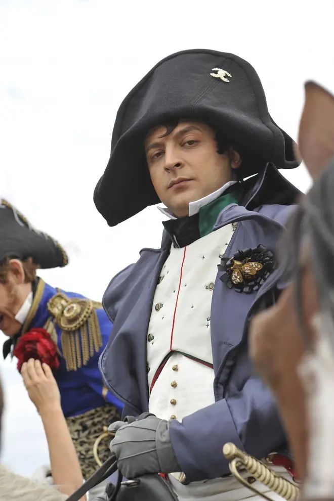
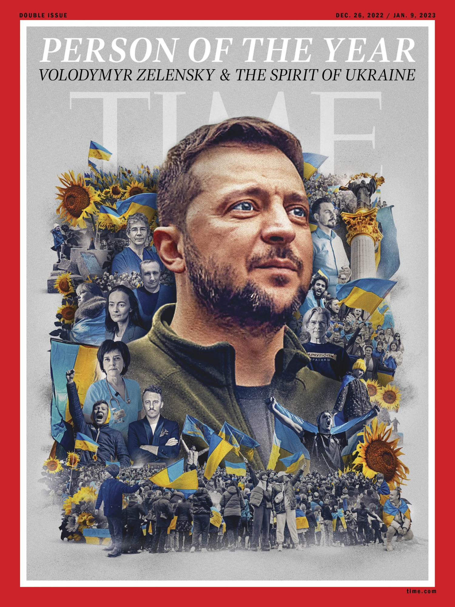
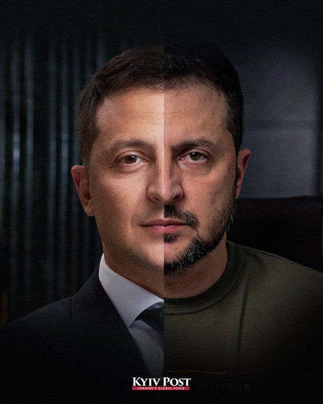
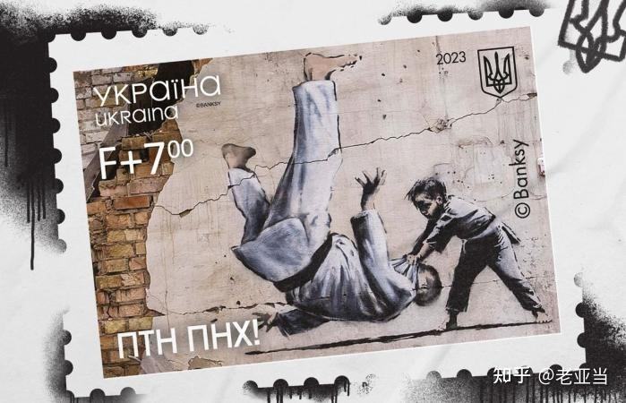
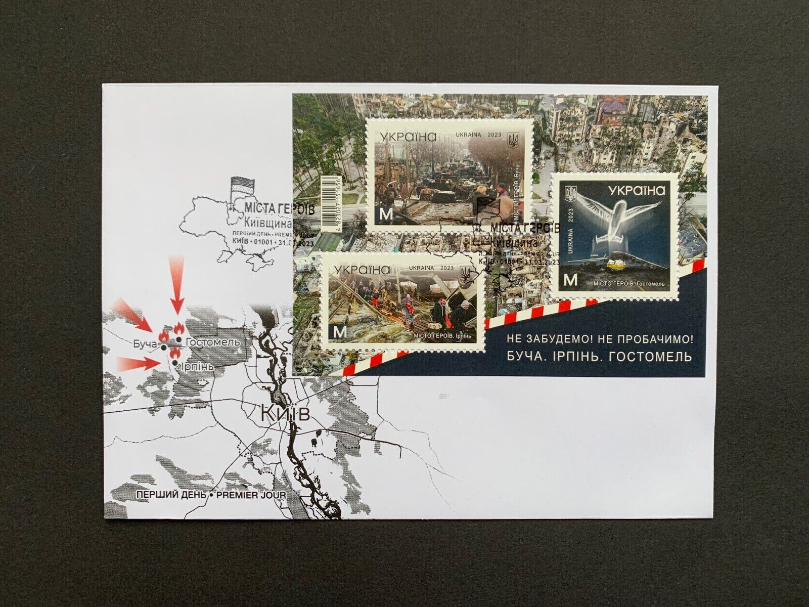
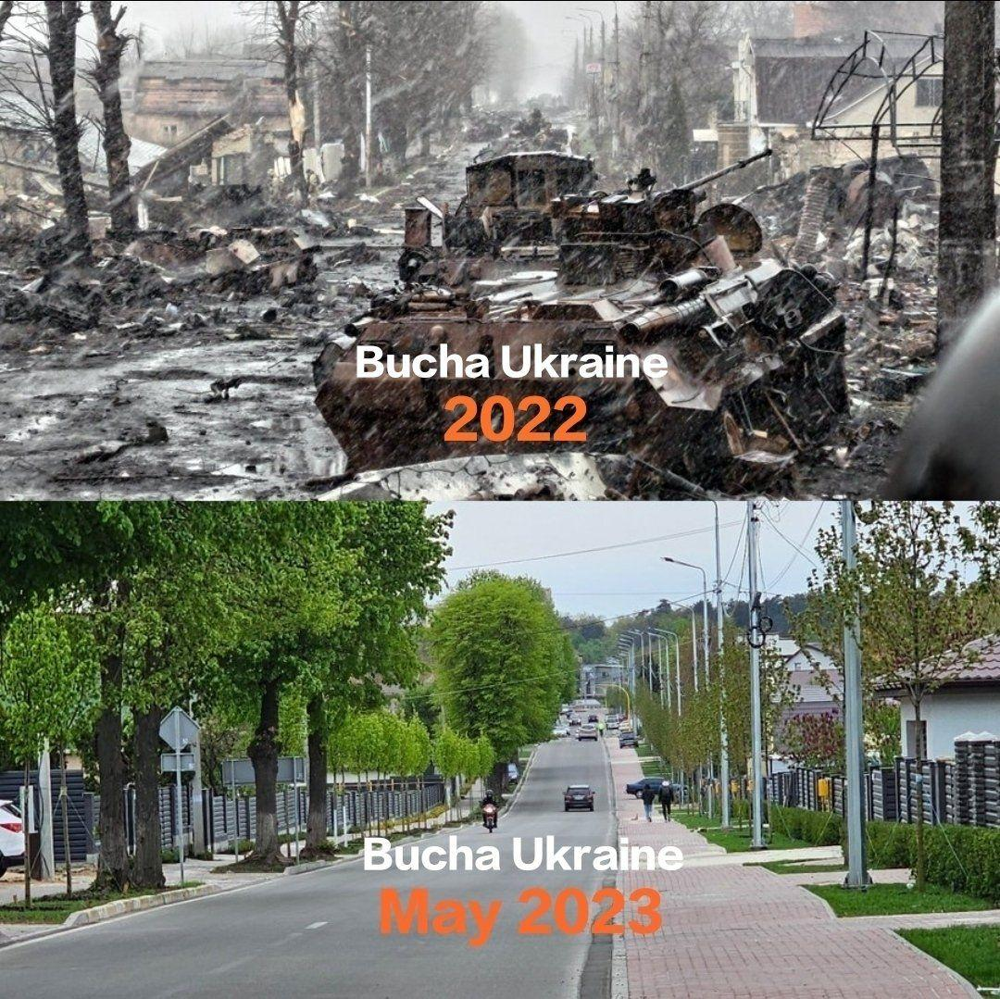

* toc
{:toc}

# 俄乌战争：疾风篇

## 泽连斯基（续）

2013年俄罗斯1台（前身苏联中央电视台二套）蓝光之夜晚会。

开场的两个主持人一个是马克西姆加尔金，是从勋宗时代就已经是“人民艺术家”的苏联天后普加乔娃的丈夫，因为两口子反对战争年初被俄罗斯政府加进“外国代理人”名单，现在已经带着老婆孩子移民以色列。另一个是泽连斯基，当时是俄语圈喜剧顶流。

https://www.bilibili.com/video/BV1Q84y1k7dT/

泽连斯基在俄国跨年节目上歌舞2013(完整版)

https://zhuanlan.zhihu.com/p/564591728

泽连斯基，一个演员到总统的“无缝连接”

https://www.bilibili.com/video/BV1Gr4y1672i

钢琴演奏大师泽连斯基

https://www.zhihu.com/question/587586045

一听到枪响就屁滚尿流的小演员（泽连斯基参演影片片段）

---

普京的爸爸是红军，泽连斯基的爷爷也是红军。如果看战功的话，泽连斯基的爷爷在二战中的战功比普京的爸爸要更高一些。

泽连斯基的爷爷名叫谢苗·伊万诺维奇·泽连斯基，有4个兄弟，全部参加了抗击纳粹的苏联红军，其中3个兄弟战死，牺牲于反纳粹的战场上。只有泽连斯基的爷爷一直活到了抗战胜利，成为唯一一个活着回到家的独子。

1941年夏天，克里沃罗格市17岁的居民谢苗·泽连斯基自愿加入红军。谢苗·泽连斯基一路奋战来到柏林。由于勇气和英雄主义，他被提名亚历山大·涅夫斯基勋章，但被授予第二颗红星勋章。

伊萨克·阿布拉莫维奇·泽连斯基，苏共中央委员会书记处书记，莫斯科第一书记。泽连斯基的远亲。

https://zhuanlan.zhihu.com/p/683838752

80年前，乌克兰总统泽连斯基的祖父被授予红星勋章

---

巴拉斯回忆他第一次见到拿破仑，“那是一个畏畏缩缩拘谨的年轻人，他穿着可笑，头发乱糟糟的，根本不属于上流社会，几乎什么都不懂，什么都要向我请教，巴望着我给他向上爬的机会。”

德拉克勒斯回忆第一次见到希特勒，“他是一个可笑的穷光蛋，几乎一无所有，没什么值得说的地方。”

托洛茨基回忆第一次见到斯大林，“他是没有任何才华和思想的格鲁吉亚人，准确地说，一个无知的亚洲人。”

多年以后，泽连斯基面对巴赫穆特的将士，他准会想起，他曾在普京资助下，演过拿破仑。

1789年法国大革命爆发，拿破仑回到了科西嘉岛，希望趁机争取科西嘉的独立，他在自己的故乡科西嘉岛组织领导了一个国民自卫军营，想为家乡的独立自由干出一番宏伟事业。

1804年，拿破仑在法国登基称帝。而他随后的第一件事就是宣布：科西嘉是法国不可分割的一部分。

---

2014年11月，泽连斯基被小卡德罗夫派人在基辅揍了一顿（原因是泽在节目里讽刺普京和卡德罗夫），被好心人送到了医院；12月这帮人烧了他的车；2015年3月基辅当局才抓到他们，当时还在搜集泽亲人的信息。

估计挨揍这件事对他从政是有促进作用的。

---

2021年，泽连斯基以阅兵的名义点了西尔斯基的将，受阅的队伍全是西尔斯基的本部兵马。然后干净利落的换掉了总司令霍姆恰克和总参谋长科尔尼丘克。

---

三大竞选目标：反腐败、反寡头、结束持续多年的乌东军事冲突。

在选举的时候乌克兰人只有两个选择：不好和更不好。

一边是小偷，一边是小丑，你们会选谁呢？

我们都不是傻子，我们不可能为了他电视剧演了个好总统就把票投给他，但是相比于波罗申科和季莫申科这些自私的寡头小偷，我们宁可把票投给一个演员政治素人，我们有的选择吗？

打仗了啊，虽说他执政能力不强，至少他是真心支持和俄国人打仗，为了领土完整我们也只能支持他啊，他起码还能和以美国为首的北约要来军费，没有他也许那些寡头早贪污完跑路或者降了，还是那句话，我们除了支持他有的选择吗？

https://www.bilibili.com/video/BV1Tr4y1a7XW/

乌克兰人苏雪佳没有料到她的这个UP发出还不到10天，菜鹅闪击乌克兰。在2月25日的视频中，苏雪佳表示“也许明天我的国家就不复存在了。”

---

央视记者：俄罗斯说你们向北约索要武器，只是火上浇油，不利于谈判！

泽连斯基：我们一点儿也不在乎俄罗斯怎么想，俄罗斯从一开始就向我们提供武器呀！你看他们逃跑的时候，留下了那么多坦克和火箭弹！我们很感谢他们提供的武器。

CNN：你希望乌克兰人民如何记住你？你希望你的子女如何记住你？

泽连斯基：一个热爱生活的人，爱家人，爱祖国。绝对不是英雄。。。一个普通人。

---

2022年4月，基辅战役胜利之后。美国人Les Claypool写了一首歌《Zelensky: The Man With the Iron Balls》。

One person can make a difference/ Be they short, thin, fat, or tall/ That person can live with dignity/ If they stand with some iron balls.

就算演员本人是个投降派，最起码你得让人家下台有个交代吧。就连中国历史上最丧权辱国的赵构，人也是被金军打进太平洋了才变怂的。

基辅，哈尔科夫，乌军主力，俄军一个也没拿下。演员就算是个克格勃间谍，现在也没法让步啊。

我不认为他有军事天才，能判断出俄军的拉胯，但他选择了留在基辅，是准备殉国的。

扶大厦于将倾，挽狂澜于既倒。

少康以一旅而兴夏，肃宗以匹马而昌唐。

https://user.guancha.cn/main/content?id=702592

乌克兰小姐姐：我为什么选泽连斯基做我们的总统？

https://www.zhihu.com/question/321165966

如何看待演员泽连斯基2019年乌克兰大选高票当选乌克兰总统？

https://www.sohu.com/a/327669087_99968041

泽连斯基：我想成为乌克兰历史上最受尊敬的总统，被写入史册 

---

这张邮票上的漫画来自于乌克兰基辅州被俄军炸毁的城镇波尔江卡（Borodyanka）。著名漫画大师——班克斯（Banksy）在前往波尔江卡的废墟的时候，在其中的一面墙上画下了这么一幅漫画，后来乌克兰邮政为了纪念战争爆发一周年，在2023年2月24日正式发行了这一套邮票。

We will not forget! We will not forgive! Bucha. Irpin. Hostomel.

2月27日，俄罗斯士兵首次试图进入布查（Bucha）。一支由装甲车、卡车和火炮组成的长长编队从白俄罗斯开来，沿着该镇的沃克扎尔纳街向邻近的伊尔平镇驶去，越过伊尔平镇就到了基辅。当俄军越过铁轨，夹在一排排民房之间时，盘旋在小镇上空的乌克兰Bayraktar无人机向第一辆和最后一辆车发射了导弹，困住了纵队。埋伏在一旁的士兵和国土防卫军战士用反坦克武器消灭了其余的车辆。俄军幸存者逃离布查，留下数十辆燃烧的车辆、弹药和战友的尸体。

---

泽圣表现出了可以成为全罗斯沙皇的勇气和演技。

沙皇这个官，德国人当得，格鲁吉亚人当得。泽圣小罗斯人凭什么当不得。

就在前几天，绍伊古也去了前线，还在直升机上观摩了俄军阵地，但是竟然有网友报出了绍伊古的位置。离前线75km左右，海马斯都打不到！！泽圣呢？离前线大约3-5km。

---

国家警卫局：我们只有15分钟时间撤离，再过45分钟我们就会被包围。

泽连斯基：每个人都有家庭，我不责怪任何人，如果你们想走——现在就走。如果我们不在这里，人民就会停止战斗。

---

妻子叶莲娜·泽连斯卡娅，婚前姓氏基亚什科（Кияшко），生于1978年2月6日，是他的同学，在95街区担任编剧。二人在2003年9月6日结婚。女儿亚历山德拉生于2004年6月15日，曾出演电影和电视节目。儿子基里尔生于2013年2月21日。

---

在首都以外的某个地方，有一个安全的地堡在等着总统，其装备可以抵御长时间的围困。泽连斯基拒绝去那里。相反，在入侵的第二个晚上，当乌克兰军队在附近的街道上与俄罗斯人作战时，总统决定走到外面的院子里，用手机拍摄一段视频信息。“我们都在这里”。

泽连斯基曾对逃亡的官员甚至军官的数量感到震惊。他没有用威胁或最后通牒来回应。如果他们需要一些时间来疏散他们的家人，他允许了。然后他要求他们回到自己的岗位上。他们中的大多数人都这样做了。

3月初，当俄国人仍在炮击基辅并试图包围首都时，总统在他的两个朋友和一小队保镖的陪同下，秘密地开车离开了他的驻地。当泽连斯基停下来与检查站的乌克兰军队交谈时，“他们都要惊掉了下巴。总统没有迫切的理由要离俄罗斯阵地那么近。”他说，他只是想来看一看，并与前线的士兵们交谈。

几天后，泽连斯基进行了一次被助手们称为 “罗宋汤之旅” 的旅程。在靠近城市边缘的一个检查站，总统遇到了一个人，他每天都会为部队带来一锅新鲜的罗宋汤。他们站在那里，在敌人的狙击手和大炮的射程内，就着面包喝一碗浓汤，谈论着前苏联以及苏联解体后俄罗斯人的趣事。

他不是一个有权在地图上调动部队的军事战略家，而是一个沟通者，一个活生生的国家象征，他吸引和保持世界关注的能力将会影响他的国家的生死存亡。

https://zhuanlan.zhihu.com/p/527807023

“小丑”泽连斯基的“蜕变”：从被乌克兰右翼唾骂的“亲俄”懦夫到举国称颂的抗俄英雄
