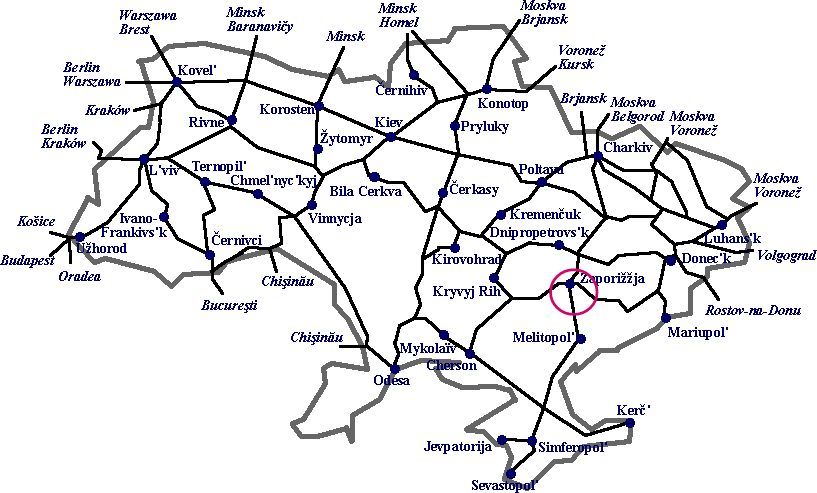
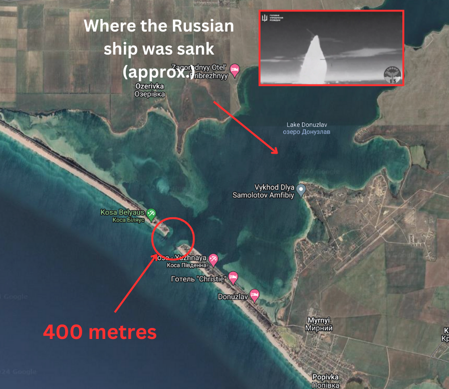
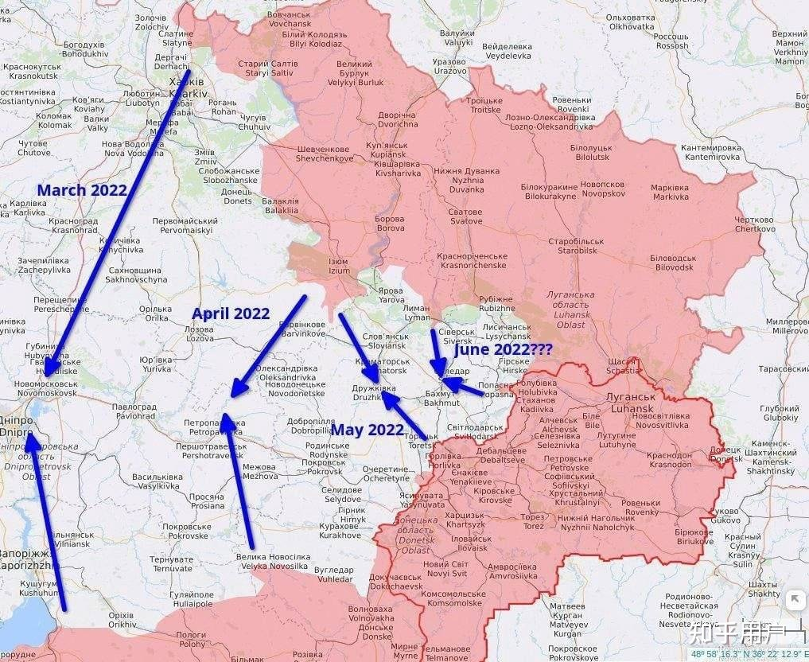
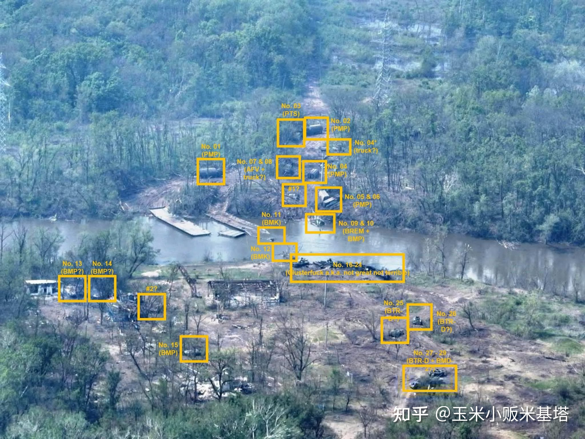
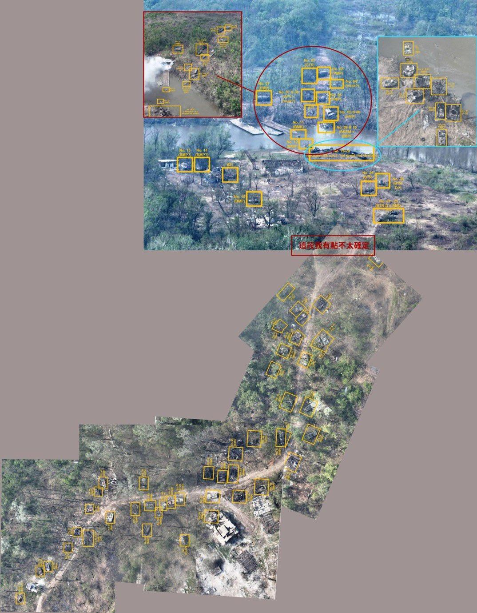

* toc
{:toc}

# 俄乌战争：苍天篇

## 莫斯科号（续）

扎波罗热在乌铁路网中的位置，乌克兰在战争初期守住了这个重要枢纽，使得俄军无法整合苏联时代的铁路网。

这就是为什么这些登陆艇会在克里米亚，他们本来应该跟着黑海舰队的其他船在新罗西斯克躲导弹到战争结束。

https://www.zhihu.com/question/636703110

乌克兰称26日在对克里米亚的袭击中炸毁了俄军“新切尔卡斯克”号登陆舰，哪些信息值得关注？

---

伊万诺维茨”号于1988年开建，当时名为R-334号，一年后建成并加入苏联黑海舰队。

1997年，根据俄乌双方的协议，该舰归属俄罗斯一方。

多努兹拉夫湖（Донузлав）是克里米亚半岛上最深的咸水湖，可以用来停泊远洋船只。之所以叫湖是因为有两个防波堤把湖本身和黑海隔开，中间只有一个大约400米的开口给船只出入。

这个开口窄到，2014年俄罗斯占领克里米亚时，俄罗斯海军自沉了两艘退役的巡洋舰就堵住了出口，阻挡乌克兰从湖里撤出乌克兰的军舰，让俄罗斯吞并克里米亚后俘获了13艘乌克兰军舰。

https://baijiahao.baidu.com/s?id=1789697945419362386

乌军海上无人艇击沉俄军价值6千万美元的导弹艇“伊万诺维茨”号

https://www.zhihu.com/question/642511424

如何看待俄罗斯黑海舰队“伊万诺维茨”号在1月31日夜间至2月1日凌晨被击沉？

---

凯撒·卢维奇·库尼科夫，海军陆战队指挥官，就是在1943年2月14日的作战中因伤致死的，死后被授予苏联英雄奖章。

相比上次用9艘海军无人艇打沉500吨的轻型护卫舰，此次仅用三艘就打沉了比上次大得多的登陆舰，可见乌军在战术运用的突然性和协调一致性方面有了稳步的提升。

无人艇用斯拉夫神话中的战争和胜利女神名字命名为“Magura（马古拉）”。

2023年7月底，马古拉首次在海上追上并损坏巡逻舰谢尔盖·科托夫。9月23日，科托夫号和另一艘船瓦西里·拜科夫号将再次受损，但没有沉没。

2023年夏天，无人艇项目竞争激烈。SBU已推出主要产品SeaBaby，并与一家制造Mamai高速无人艇的私营公司合作。SeaBaby是一个多用途平台，从事扫雷、打击桥梁等静态目标，甚至已经安装了火焰喷射器系统。

Mamai是一种远程无人机，携带的炸药不多，但能够在很远的距离击中大型目标。

俄罗斯630近防炮完完全全垃圾中的极品垃圾，连海面目标都打不中还特么防空？中国海军可被坑惨了，登陆舰都装备这玩意。。。

无人驾驶河流无人机黑寡妇 2可以摧毁水面目标，包括小型船只。

2024年12月31日，GUR特种部队首次在历史上，通过搭载导弹武器的Magura V5成功打击空中目标。在黑海，位于被暂时占领的克里米亚塔尔罕库特角附近的战斗中，使用P-73（SeaDragon）导弹击毁了一架俄罗斯米-8直升机。

2025年5月4日，一架俄罗斯苏-30战斗机被新罗西斯克附近的一架乌克兰海军无人艇发射的导弹摧毁。

https://www.zhihu.com/question/644308685

乌方称击沉俄黑海舰队大型登陆舰“凯撒·库尼科夫”号，具体情况如何？

https://zhuanlan.zhihu.com/p/685418924

黑海哀歌 俄罗斯巡逻艇谢尔盖·科托夫号不幸被乌克兰击沉

https://www.zhihu.com/question/647294148

乌方称击毁俄罗斯黑海舰队一艘护卫舰，目前局势如何？哪些信息值得关注？

https://www.zhihu.com/question/1902154726465832041

如何评价俄罗斯海军航空兵一架苏-30SM战斗机被乌克兰无人艇使用R-73导弹击落？

---

马汉认为，一支不敢寻求决战、无法保护海上交通线的舰队，无论吨位多大，都只是"存在舰队"——它的存在意义仅限于阻止敌方完全无视它，而非真正控制海洋。

敖德萨等港口恢复货运，不仅说明乌克兰打破了俄海上封锁，更说明非对称作战可以逆转传统海权。这极大挑战了马汉理论中"大舰巨炮"的预设，但并未否定海权本质——控制海上交通线的能力现在由乌克兰（及其技术支持方）掌握，只是手段从战列舰变成了分布式杀伤链。

主动认怂逃往本土克拉斯诺达尔边疆区的新罗西斯克市之后，黑海舰队也未安生。

2024年5月19日乌克兰无人机和无人舰艇第一次对新罗西斯克市的黑海舰队残余舰艇实施了袭击。

2024年7月2日，乌克兰无人舰艇又对新罗西斯克市的黑海舰队实施了新的袭击。

不是因为避战保船所以失去了制海权，而是因为失去了制海权才避战保船，然后进一步失去克里米亚的制空权。

它们本身就是瘸腿的，本质上是新时代蚊炮船，所有船都强调进攻而基本没有防空能力，存在就是为了对陆攻击，根本没有考虑过要和乌克兰进行海上对抗，遇到上了强度的海上和空中攻击，就只能纷纷咕嘟咕嘟潜水了。

本质上克里米亚也是这样的，现在全境都在乌克兰攻击范围内，夺取克里米亚是为了当成跳板攻击乌克兰，但现在连克里米亚都不能自保，谈什么当做跳板攻击。

https://zhuanlan.zhihu.com/p/718576483

无人舰艇突袭新罗西斯克港，黑海霸主为何沦落为黑海老鼠？

https://zhuanlan.zhihu.com/p/720401050

俄海军史上抹不掉的羞辱，怕袭击黑海舰队又从新罗西斯克港撤离

https://zhuanlan.zhihu.com/p/1984302672510216131

乌克兰今天对停泊在新罗西斯克的俄罗斯潜艇发动了大胆袭击，引发了俄罗斯军事博主的愤怒和嘲讽（2025.12.16）

https://www.zhihu.com/question/2029487991702271899

三艘军舰被炸，俄罗斯会对乌克兰采取什么样的报复？

---

2023年8月16日，第一艘船离开敖德萨港。从那时起一年来，2300多艘装有各种货物的船只使用了这条走廊。转运总量接近6550万吨，其中近80%是乌克兰出产的谷物。比较往年有增无减。而俄罗斯的黑海舰队反倒是呆在远离乌克兰的港口内不敢轻举妄动。

---

2026年3月24日，乌贼的无人机打卡了维堡造船厂，重伤了正在建造中的23550型破冰巡逻舰普尔加号（475），该舰被无人机命中后发生倾覆，同时还引发了火灾。

---

2018年11月25日，刻赤海峡事件中，“伊祖姆鲁德号”参与拦截并攻击乌克兰海军舰艇。当时，乌克兰三艘舰艇试图通过刻赤海峡前往亚速海，最终遭俄方拦截、开火并扣押，24名乌克兰海军官兵被俘。这起事件成为俄乌冲突升级的重要转折点之一。

2026.7.14 乌海军出动国产Sargan-3000自杀式无人水面艇，奔袭新罗西斯克港，精准打击停泊状态下俄联邦安全局（FSB）22460型（红宝石级）边防巡逻舰伊祖姆鲁德号（Izumrud，舷号354）。

---

沃洛申说224刚开始时，鹅试图在敖德萨空降，但是随着伞兵全被投放到海里噶了后，行动宣告失败。

## 北顿战役

本节的北顿战役除了包括北顿涅茨克+利西昌斯克攻防战之外，还包括伊久姆春季攻防战、鲁比日内攻防战、波帕斯纳攻防战。

北顿城战役：2022.5.6～2022.6.25

利西昌斯克战役：2022.6.25～2022.7.3

---

利沃夫大饺子，第聂伯罗中饺子，顿巴斯小饺子，北顿千里香馄炖

https://zhuanlan.zhihu.com/p/585213985

最后的攻势：俄乌北顿内茨克之战回顾

---

https://zhuanlan.zhihu.com/p/513101094

俄军的北顿涅茨河浮桥是怎么被打爆的

https://new.qq.com/rain/a/20220531A0CNQG00

俄军强渡北顿涅茨河惨遭团灭，低级错误遍地，堪称渡河战反面教材

https://zhuanlan.zhihu.com/p/682909074

比洛霍里夫卡渡河点

https://zhuanlan.zhihu.com/p/1904924139027960950

北顿涅茨河战役期间俄军渡河失败（美国陆军《步兵》杂志2025年春）

---

俄国补贴给所有顿、卢军的人月薪25,000卢布（约2500人民币）。在打烂的顿巴斯，这往往是仅有的工作。这些人为钱当兵后，被嘲笑为“二万五” (类似中文语境中的二百五)。

至于那些基层的小斯特列科夫，就老老实实接受阿尔巴特精英指挥，去啃东部碉堡群吧。打死乌军除外患，自己牺牲除内乱。在阿尔巴特看来，这些形形色色的魔怔人，最好全都战死东乌，省的战后还要给他们留位置。

阿尔巴特街(Arbat Street)是莫斯科市中心的一条著名步行街，也是俄罗斯国防部所在地。

---

4月，顿涅茨克某著名钢琴家在马里乌波尔附近的作战中丧生。他是怎么从军的？

“爱乐乐团全部上当了！他们听说是来拍个节目就回家，结果全部被拉走！”

“我们也一样，我们也被骗了，顿巴斯的歌剧团、马戏团都是”

“他不是志愿者！！！像所有的音乐家一样！”

https://zhuanlan.zhihu.com/p/510586867

Z战争和总动员（上）

https://zhuanlan.zhihu.com/p/510673824

Z战争和总动员（下）

https://zhuanlan.zhihu.com/p/497789494

“人人可当炮灰”50天以来，DNR许多居民一直躲避强制动员战争。这是其中一位的故事

---

https://www.thepaper.cn/newsDetail_forward_18439240

乌克兰总统泽连斯基视察卢甘斯克地区利西昌斯克前线
