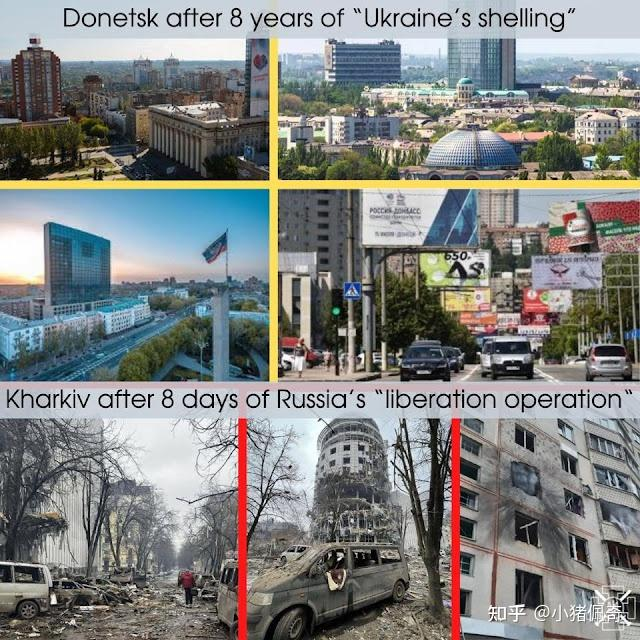
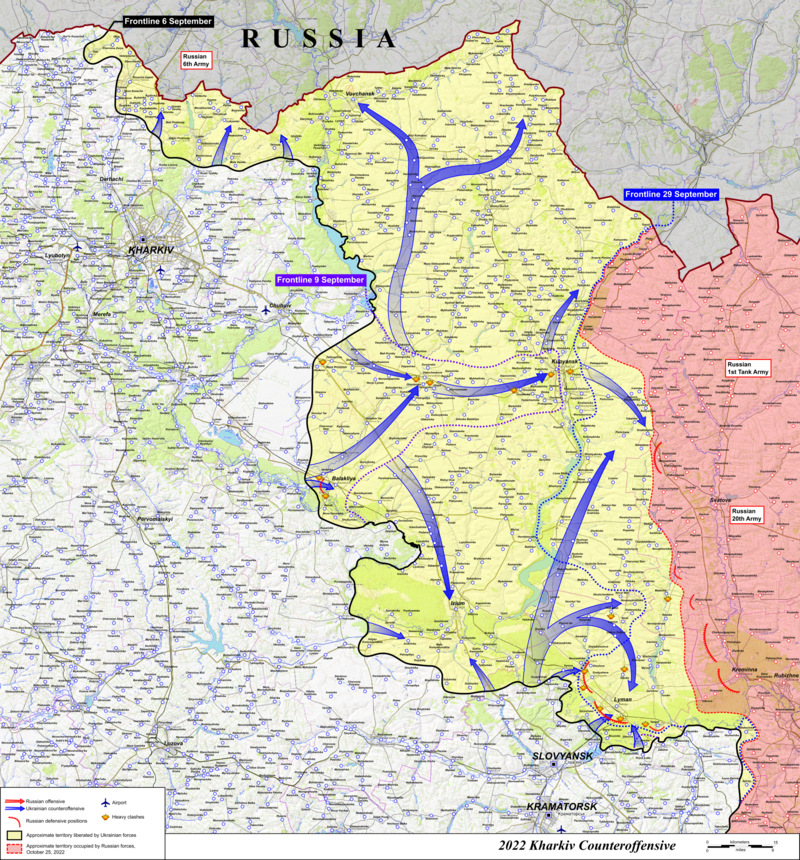
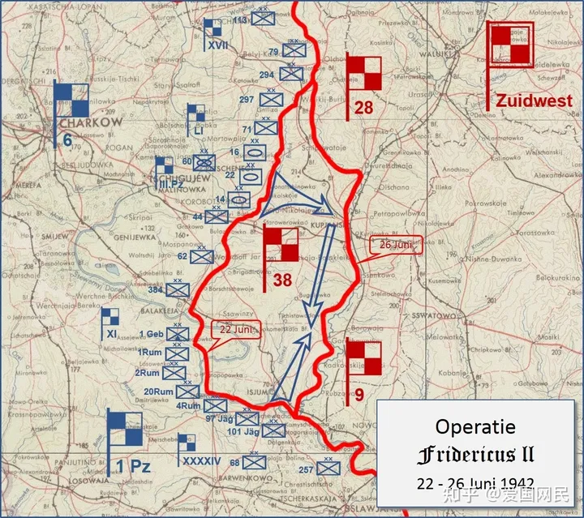
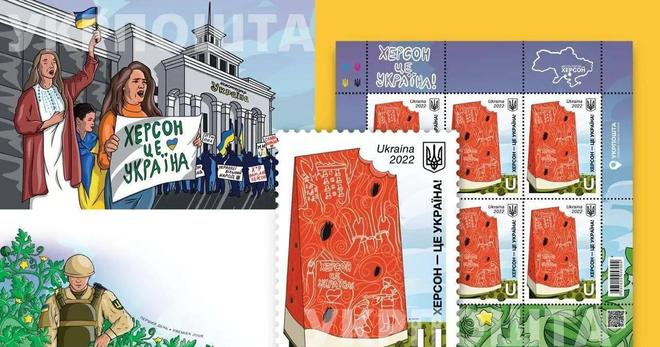

* toc
{:toc}

# 俄乌战争：苍天篇

## 哈尔科夫战役

2022年秋季战役：2022.9.6～2022.9.16

沃夫昌斯克战役：2024.5.10～2024.5.24

库皮扬斯克战役：2025.9～

---

https://www.zhihu.com/zvideo/1551802887226732544

乌军士兵在Kharkiv州发动反攻前齐唱国歌。

---

这次战役俄军被俘人员很多，以至于乌军出现″用来捆绑的胶带不够、安置俘虏的地点不够″的报怨。而俄军方面，当乌军为快速赶路，没空收容俘虏时，俄军为了避开随后赶到的″老车臣兵″，追着乌军装甲车要求收容。

9月6日，乌军在巴拉克利亚城郊俘虏俄军西部军区前任总司令（于4日刚被免职）安德烈·西切沃伊中将，这是二战以来俄（苏）军被俘的最高级将领。

https://zhuanlan.zhihu.com/p/587023326

梦回1942：俄乌伊久姆之战回顾

https://www.zhihu.com/question/552742207

如何看待俄方消息伊久姆已经被乌克兰攻陷？

https://www.sohu.com/a/584049380_374379

俄乌战场，形势正发生重大变化！

https://news.ifeng.com/c/8JCKRhgLczV

声西击东 乌克兰发起了双线大反攻

https://zhuanlan.zhihu.com/p/2014477635888097238

决战东乌之哈尔科夫反击

---

当时一名叫亚历山大的侦查连长带着小分队渗透到库皮扬斯克拍了这张照片，然后乌萝利用这张照片大肆宣传。虽然当时乌萝的大部队还没到，但是也导致了鹅指挥系统的混乱，守军仓促撤离，也就是说库皮扬斯克的鹅其实是被吓跑的。

第144摩步师直接被正面打崩，跑都没来得及跑直接建制被消灭，人跑依久姆的森林里两手空空和亚速营玩捉迷藏，一个师的装备全进乌克兰军火库了，这个师日后在别尔格罗德花了一年重建。

---

https://www.zhihu.com/question/655569797

俄军在哈尔科夫再次发动大规模进攻，如何看待俄军此轮攻势，能否达到预定目标？

https://www.zhihu.com/question/657263155

如何看待乌军成功反攻北沃夫昌斯克并收复部分失地？

https://www.zhihu.com/pin/1905017483083101113

沃夫昌斯克战役一周年

---

2025.12 库皮扬斯克反击战。

这一波京子的脸算是丢到姥姥家去了，一开始认为乌贼那边在说假话搞信息战，发动国家机器为叶夫库罗夫站台，金星勋章都发了，一口咬定拿下了库皮扬斯克，包围了乌贼15个营。

https://zhuanlan.zhihu.com/p/1983256771163333406

布图索夫：库皮扬斯克发生了什么？——“宪章”集群的一次成功反击

https://zhuanlan.zhihu.com/p/2000923089341535015

库皮扬斯克之战：乌克兰如何在逆境中取得胜利

## 卢甘斯克战役

Krasnyi Liman虽然位于顿涅斯克州，但是仍然属于北线，和东线距离很远，倒是离卢甘斯克很近，且后续发展也在卢甘斯克方向，故归类为卢甘斯克战役。

本节还包括克里米纳秋季攻防战、斯瓦托夫攻防战、库皮扬斯克攻防战等。

利曼春季战役：2022.5.23～2022.5.27

利曼秋季战役：2022.9.16～2022.10.2

第三次利曼战役：2025.10.17～2026.9

---

红利曼上虎贲垮，千里驰援有五八，非我见死不相救，奈何乌军有海马！

利曼于9月30日“加入”俄联邦，10月1日即回归乌克兰，有人戏称这是“俄联邦一日游”。

https://zhuanlan.zhihu.com/p/568997474

饺子——红利曼攻防战V2.0

https://www.zhihu.com/question/555976710

俄军还守得住莱曼/利曼吗？

https://zhuanlan.zhihu.com/p/570377558

漫长的防线——克里明纳-斯瓦特沃的防御

https://m.sohu.com/a/552397480_767131

红利曼还是利曼，俄军乌军称呼为何不一样？被抹去历史的战略重镇

---

安东尼奥·卢乔·维瓦尔第（Antonio Lucio Vivaldi，1678—1741），意大利威尼斯人，巴洛克时期作曲家、小提琴家。

https://www.zhihu.com/question/2080728827152577252

如何看待乌军在莱曼北部取得重大反击成果?（2026.9）

https://zhuanlan.zhihu.com/p/2084334211369116774

俄罗斯正逼近斯拉维扬斯克和克拉马托尔斯克附近的“要塞带”：乌军在利曼附近的反攻将如何影响这一局面

https://www.zhihu.com/answer/2087879606397298541

维瓦尔第行动（截止2026.9.28）

---

俄军的分割战术非常的成功，目前已经切断了Senkove（先科夫）的桥梁，乌军没有被围，但因为沿河通道的阻断，补给压力增大，使得南侧乌军目前的颓势比较大。

https://zhuanlan.zhihu.com/p/5946362740

乌克兰战局追踪-2024年11月9日

## 赫尔松战役

本节包括所有赫尔松地区的战役，即赫尔松春季战役、赫尔松秋季战役、卡霍夫卡大坝事件、第聂伯河攻防战等。

---

俄军2-3月份在赫尔松左岸-扎波罗热的攻势。

https://zhuanlan.zhihu.com/p/586516245

赫尔松左岸-扎波罗热战役回顾

https://zhuanlan.zhihu.com/p/657717849

南线快速崩溃之谜

---

我寻思巴普洛夫的狗训练几次也都形成条件反射了，俄军是连狗都不如吗？还在同一个地方送。。。

俄罗斯的军官们，不再敢用无线电通信了。他们的对话都会被破译。从而成为乌克兰军的情报。

所以，现在俄罗斯的军官们开始用最原始的“见面谈”的方法，聚集在一起开会。开完会再分散行动。执行计划。这样军官扎堆开会。给了乌克兰部队有乘之机。

https://www.zhihu.com/question/523504445

乌克兰为何能屡次袭击赫尔松机场？

---

每次过节，俄罗斯都要给个大惊喜。中秋伊久姆，十一红利曼。现在双十一也没落下，那么下一次“善意撤退”是双十二还是元旦呢？

俄罗斯从2月份忙活了大半年，现在就得到了一个没有扎波罗热的扎波罗热州，和一个没有赫尔松的赫尔松州。

没有一只雄鹰能够飞过第聂伯河的中央，果戈里这样赞颂母亲河的宽广。

---

基辅战役之后，我家已经不吃河鱼了。

莱曼战役以之后，我家不再吃猪肉了。

赫尔松战役之后，我家明年不打算吃西瓜了。

如果许多俄军开始溺水身亡是真的，黑海里的鱼虾近期也不要吃了。

与此同时，乌军的总指挥却发信息说：尝了没有？今年林子里的蘑菇特别好吃！

---

泽连斯基在赫尔松解放两天后就到了赫尔松，普京在赫尔松被占领的8个月都没来过。

经过近9个月的负隅顽抗之后，基辅匪帮、班德拉的子孙、纳粹余孽泽连斯基终于支持不住，叛逃至俄罗斯的赫尔松地区。

https://www.163.com/dy/article/HM031R3U05534H4H.html

乌克兰国家邮政局准备发行“解放赫尔松”邮票

https://www.zhihu.com/question/566648738

如何评价泽连斯基视察刚刚收复的赫尔松市?

https://k.sina.com.cn/article_6427351817_17f199b0900100efyj.html

2000年！普京驾驶战斗机直飞车臣战场鼓舞士气

---

夜幕降临，赫尔松民众点燃篝火，唱起古老的哥萨克民歌“红卡琳娜”（草地上的红荚蒾），俄国占领赫尔松时（又双叕）禁了这首吟唱乌克兰浆果的歌。

草地旁有株红卡琳娜枝头被压弯，为何我们的荣光乌克兰如今愁眉不展。而我们要扶起那红卡琳娜。让荣光乌克兰再开颜！

草地上的红荚蒾最早发表于1875年，1914年由乌克兰作曲家斯捷潘·查涅茨基(Stepan Charnetskii)改编为现在的版本，并在1917年到1921年被反抗苏俄的乌克兰人民军广泛传唱。

红荚蒾是乌克兰文化的象征，代表了家庭和祖国。1919年到1991年，任何演唱这首歌的乌克兰人都会被监禁甚至流放，但仍然被乌克兰爱国者们秘密地传承了下来。2014年俄罗斯吞并克里米亚后，在克里米亚演唱这首歌也会被处以罚款和监禁。

班杜拉琴（Bandura）最早是鲁特琴的一种，演奏方式和吉他相似，只有5到12根弦。18世纪后，班杜拉琴与拨弦扬琴（Psaltery）相结合，弦逐渐增多，20世纪初时已经增加到31根，20世纪中期更是扩展到68根。

历史上，班杜拉琴主要用于为乌克兰民歌、史诗、圣歌和民间舞蹈伴奏。1876年时，沙皇亚历山大二世颁布了秘密法令，全面禁止乌克兰语的音乐表演，弹唱班杜拉琴的游吟诗人被迫成为乞丐，受到残酷的迫害。直到1920年代，由于苏联对乌克兰文化相对宽容，班杜拉琴才重新受到人们的欢迎，开始出现教授班杜拉琴的音乐学院。然而好景不长，1920年代后期，苏联为了控制乌克兰民族意识的觉醒，开始限制乌克兰人的民俗文化，许多班杜拉琴乐手被逮捕，一些人被送往西伯利亚的集中营，还有一些人被送去挖白海运河。

斯大林去世后，对乌克兰民俗文化的迫害宣告停止，许多班杜拉琴乐手被平反，琴厂和音乐课都开始恢复。然而苏联继续掌控着班杜拉琴艺术，禁止男性学习班杜拉琴，只有通过严格政审后的女性可以演奏。曲目也受到严格审查，民族史诗和宗教内容都被禁止，只能演奏浪漫爱情的主题和古典钢琴乐曲。

Helena Androsova(Eileen)在开战后演唱的版本效果不错：

https://www.bilibili.com/video/BV1uY411J7pY/

乌克兰第3军团一名代号“阿喀琉斯”的士兵，在顿涅茨克州斯洛维扬斯克一栋遭俄军制导航空炸弹摧毁的住宅废墟中，发现了一把已有约50年历史的班杜拉琴。整栋建筑几乎被夷为平地，而这件乌克兰传统乐器却奇迹般保存了下来。
