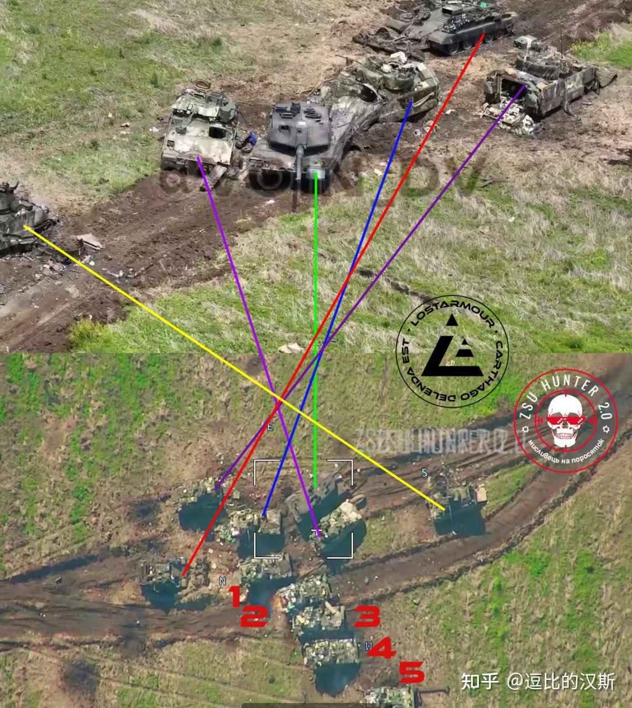

* toc
{:toc}

# 俄乌战争：苍天篇

## 顿涅斯克战役（续）

2026.2～8 亚历山德里夫卡反攻。

https://zhuanlan.zhihu.com/p/2018989916856546385

乌克兰突然发起反攻，在埃隆·马斯克的帮助下

https://zhuanlan.zhihu.com/p/2071909387141132850

乌军在亚历山德里夫卡方向的进攻：目前已知情况及前景如何

---

2025.10～ 康斯坦丁诺夫卡战役。

康斯坦丁诺夫卡曾经制造克里姆林宫塔楼顶端的红宝石色五角星，以及装饰弗拉基米尔·列宁墓的玻璃——这座乌克兰东部工业城市曾帮助建造了这些苏联权力的象征。

https://zhuanlan.zhihu.com/p/2059983021235868791

俄罗斯逼近让克里姆林宫闪耀的城市

https://www.zhihu.com/pin/2060761797410415674

无人机地狱：徒步穿越顿巴斯最后一道防线，直抵俄军已攻入的康斯坦丁诺夫卡

---

2022.7.3～2022.9.8 第一次Siversk战役。哈尔科夫反击战之后，攻势停滞。

2025.9.25～2025.12.23 第二次Siversk战役。

---

https://zhuanlan.zhihu.com/p/1891575215038902855

他们绝不能通过！恰索夫亚尔战役一周年纪实

---

https://zhuanlan.zhihu.com/p/28871335828

俄乌战争中的顿巴斯战线详解——（一）完整防线下的具体战略

https://zhuanlan.zhihu.com/p/30599823661

俄乌战争中的顿巴斯战线详解——（二）顿河君士坦丁罗夫与塞弗尔斯克是否会爆发主力对决

https://zhuanlan.zhihu.com/p/1910106414761895263

乌克兰科斯特扬季尼夫卡（Kostyantynivka）方向形势吃紧：具体情况和原因（5月25日）

https://zhuanlan.zhihu.com/p/2065633463106119331

法国军博CM:俄军持续推进已导致北顿方向形势恶化，乌军必须尽快决策。

## 扎波罗热战役

扎波罗热的意思是“急流结束”。

由于乌官方并未公布扎波罗热反攻的开始时间，所以一般以2023.6.5乌军开始火力侦察，作为战役的开始。

同年10月，乌军攻势停止，转入防御阶段。

---

苏联从乌克兰北部、东部和俄伏尔加河流域大量移民，把扎波罗热的草原变成一个又一个集体农庄，圆了赫鲁晓夫的玉米与小麦梦想。

移民也为这片曾经的草原带来大量远方的名字。就像“新约克”“新英格兰”“新西兰”一样，这里的集体农庄多以移民旧地命名，只是前头加上一个HOBO，英文转写novo，意思是新。

所以，在扎波罗热州，在这片古今征战的战场，会有大量以“诺沃”开头的村庄，后面跟着的可能是鼎鼎大名的地方——“诺沃顿涅茨克”、“诺沃哈尔科夫”、“诺沃基辅”、“诺沃莫斯科”……

扎州工业发达，综合经济实力在乌克兰排第四。扎波罗热变压器工厂与研究所曾是特高压输电的全球引领者，至今仍在世界上享有盛誉。

在第聂伯河的“卡霍夫卡海”畔，由6座核反应堆，组成欧洲最大的核电站，再加上3座作为应急电源的火力发电厂，构成了至关重要的“能源城”（Enerhodar）。

这里的发电量占到了乌克兰的25%，是乌克兰的能源中心。

还有著名的“马达西奇”航空发动机，第聂伯特殊钢厂等等。

---

乌军在稳住阵脚后，于接触线上打造了5个核心防御区。由东向西分别是弗勒达、大诺沃西尔卡、胡里艾伯勒、库班（奥列霍夫）、卡缅西克。其中除了卡缅西克因为年初俄军的攻势成为灰色地带，乌军退守其后的特捷普诺吉尔西克外，其余各点依旧保持了下来。

俄军在扎波罗热也形成了三大防御点，由东向西分别是波洛伊、托克马克、沃斯里夫卡，其中以托克马克最为核心。

https://zhuanlan.zhihu.com/p/601122592

关于一直没出现的扎波罗热大穿插的分析

https://zhuanlan.zhihu.com/p/625611937

关于近期乌克兰未发动反击的分析

https://zhuanlan.zhihu.com/p/626546244

逆转-俄乌战争正走向终局

https://news.ifeng.com/c/8Qc7KrypOmK

欧洲粮仓、哥萨克之乡，乌军在此最先发起反攻

https://news.ifeng.com/c/8QnpEIe1J4c

从双11到618，揭秘俄乌600公里对峙场景

---

驻扎波罗热的俄罗斯武装部队第58集团军司令伊万·波波夫 (Ivan Popov) 今天（2023.7.13）早些时候被免职。。。

SBU袭击了位于梅利托波尔一家汽车工厂内的一个鹅基地，据称鹅58集团军的司令和参谋长在此次袭击中受伤。昨天（2023.9.20）乌萝战略司令部证实袭击并摧毁了鹅一个指挥中枢。

机智的波波夫将军。。。

https://zhuanlan.zhihu.com/p/655140398

前58集团军司令波波夫与下属谈话录音

---

一支俄军希望在扎波罗热罗博季涅附近开展“敌后行动”，从而换上乌军制服对乌军进行突袭，可这项计划却被自家无人机破坏。一架俄罗斯无人机发现伪装成乌军的俄军，见猎心喜下，把他们误认为敌方并发动攻击，32名俄军被炸身亡。

随后炮兵阵地被乌军发现并被摧毁，造成19名俄军死亡，数十名俄军受伤。

下达指令的俄军指挥官遭到谴责，因为他没有把这项计划告诉其他士兵，才会导致伤亡。该指挥官目前已畏罪潜逃，俄军正在对其逮捕。

https://www.sohu.com/a/709690818_249286

冒充乌军搞偷袭，被自家无人机炸，再遭乌军集束弹药

---

乌军128旅指挥官沃瓦上校、安德烈中校、谢廖沙少校，以及其他6位上尉，另外还有很多低级军官一同被俄军伊斯坎尔德导弹团灭，目前已经有30名军官阵亡，53名军官重伤，轻伤人数目前还没有准确数字。

泽连斯基此前已经明确表示不允许公开授勋。

128旅的旅座德米特罗·利苏克上校在颁奖仪式上迟到了。活动原定于9:00举行，但临时推迟至9:30。士兵们按照他的命令在现场等待，后来通信泄露鹅的导弹大概在10点10分左右抵达，他在导弹来袭后的几分钟也到达了现场。噶了这么多精英这哥们11月5日停职调查，1月5日官复原职。

是不是很不合理？其实没啥奇怪的，明斯克2协议生效后他就开始了走私香烟的发财之旅，从LPR的边界（北顿以北）走私万宝路到索莱达，一次就是几百箱用军用卡车运输，就储存在弹药仓库内。后来一次交易中他被SBU逮了现行，他还试图向SBU塞绿币。面对调查人员的询问（因为这么大的生意他没条件自己做）他把所有的责任都自己扛了下来。法庭宣判后他也没脱军装（因为没有军事法庭），还有人为他交了保释金。

2月20日上午，位于顿涅茨克地区特鲁迪夫斯克的俄罗斯第36独立近卫摩托化旅训练场遭到乌军海马斯火箭炮的远程打击，至少65名俄军士兵被消灭。

据知情者透露，36旅的指挥官召集了大约200-300名士兵列队听长官训话，训话者为俄军东部战区第29集团军的莫伊塞耶夫少将，但这位少将却迟迟未到。。。

https://zhuanlan.zhihu.com/p/665375124

俄军一发入魂，乌军128旅炮兵指挥系统被团灭

https://zhuanlan.zhihu.com/p/684545499

俄罗斯英雄在颁奖集会时被乌克兰海马斯袭击

---

2023年反攻期间，由于执意在特定日期开始行动，联合部队指挥官无视旅指挥官关于因恶劣天气需推迟2-3天的警告。结果，全新的MaxxPro、坦克和其他军事装备在雨后黑土地上陷入泥泞，被敌人像靶场上的目标一样摧毁。那位指挥官后来为自己的“邀功”负责了吗？不……他被调任国防大学副校长。

---

第31旅直接冲过我们的阵地，而在短短4小时的战斗中：就有20多辆MaxxPro装甲车、5辆坦克，几乎全部踩上了我们的地雷——因为某个混蛋懒得来和从2022年夏天就守在那些阵地的营进行协调。

---

https://www.zhihu.com/question/605592764

如何评价乌克兰豹二坦克在6月8日的会战中被俄军击毁？

https://zhuanlan.zhihu.com/p/636255708

冲向俄罗斯的铜墙铁壁 乌克兰军队激战扎波罗热

https://zhuanlan.zhihu.com/p/637846009

在督战队的枪口下 俄罗斯士兵眼中的乌克兰扎波罗热攻势

https://zhuanlan.zhihu.com/p/642942500

俄罗斯中将师团长不幸在别尔江斯克被乌克兰击毙

https://zhuanlan.zhihu.com/p/642984280

表面兄弟之马库斯与沙拉马加

https://zhuanlan.zhihu.com/p/645393380

黄纸影响深远？浅析乌军北约旅上场情况

https://zhuanlan.zhihu.com/p/651783572

扎波罗热人喜迎王师，莫斯科人彻夜未眠

https://zhuanlan.zhihu.com/p/654324560

浅谈瓦夏9.4巡演

https://zhuanlan.zhihu.com/p/657040639

布达诺夫：我没有心情讨论乌克兰的反攻（9月17日）

https://zhuanlan.zhihu.com/p/670787768

僵局：乌克兰失败的反攻（第一部分）

https://zhuanlan.zhihu.com/p/670901766

僵局：乌克兰失败的反攻（第二部分）

https://zhuanlan.zhihu.com/p/2022454886390866239

扎卢日尼现在将反攻的责任归咎于泽连斯基，但他并非一直如此确信
