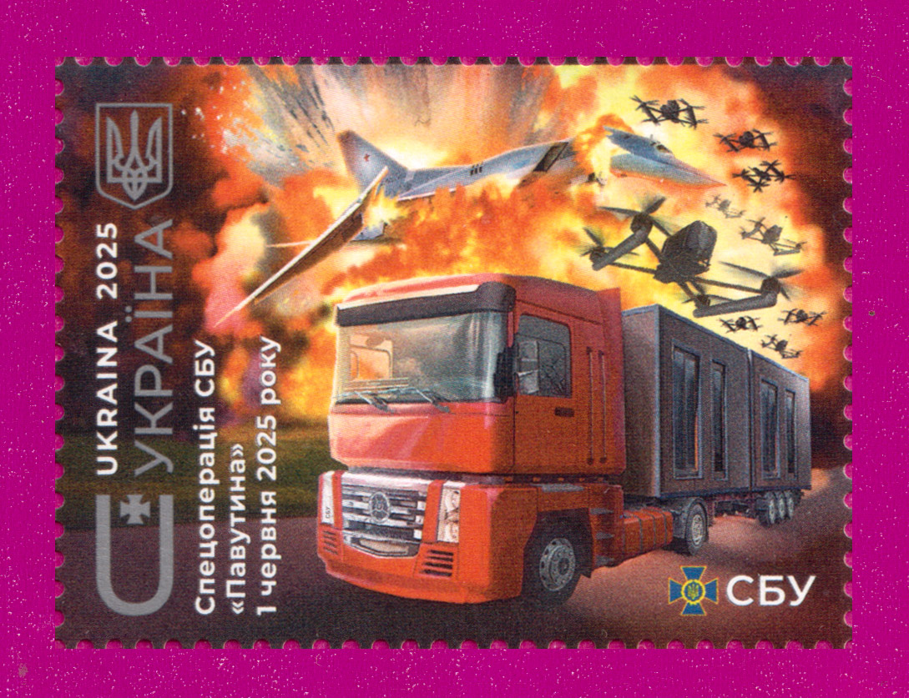
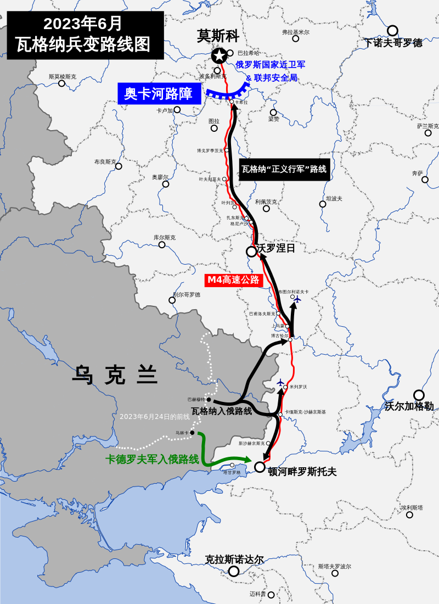

* toc
{:toc}

# 俄乌战争：苍天篇

## 游击战（续）

特维尔州就是厨子当年坠机灰飞烟灭的地方。厨子到死也没有等到他要的弹药（也可能等到了一发防空导弹），死后却一口气收到了三万吨，够他的瓦格纳亡灵军团在地下慢慢享用了。不知他在天有灵，会作何感想？

乌军成功炸毁托罗佩茨弹药库被认为是2022年战争爆发后乌军在俄罗斯境内取得的最大战果。

NASA全球火情监控系统发现当地几乎已被烈火覆盖，地震监测系统也记录到在被无人机击中后，托罗佩茨发生了一次2.8级地震，其后又接连发生了7次震级从2-2.8级的连续地震，看起来是有大量弹药被连续引爆，一些分析人士称托罗佩茨弹药库的爆炸相当于引爆了多枚小型战术核武器。

建设托罗佩茨弹药库耗资36亿卢布，2018年建成时，时任俄罗斯国防部副部长布尔加科夫剪彩时称该弹药库可以抵御空袭和导弹袭击，甚至免受核爆炸的破坏性因素影响，虽然现在他已因腐败指控而被捕。

在行动时乌军还对俄罗斯其他4个州同时发动了无人机袭击，以掩护真正的无人攻击机机群绕过白罗斯领空并成功击中托罗佩茨弹药库。

在特维尔地区这个被毁的军火库中，国防部指定的建筑商使用砖块和木头来保护弹药，而不是设计中的装甲混凝土。

https://www.zhihu.com/question/667513594

如何看待俄罗斯107军工厂及军火库被炸并引发大规模殉爆？

---

八月初，赫尔松州被占岛屿Dzharylhach有俄军集训，遭遇海马斯攻击。之前很好奇咋搞到情报的，前几天乌克兰真理报有关游击队的报道说，是俄军喝酒的时候把装有训练计划文件的U盘给掉在咖啡馆里了，这个U盘到了乌方手里。

---

2023年1月14日，俄军第52近卫航空团的33310中队向乌克兰第聂伯罗的居民楼发射导弹，造成46人死亡（其中包括6名儿童）79人受伤（包括16名儿童）的重大惨案。

2024年10月20日，凶手之一的52近卫航空团参谋德米特里·戈连科夫（Дмитрий Голенков）被发现在俄罗斯布良斯克的一个苹果园内死亡，头部疑似被锤子砸爆。

---

军方告诉弗拉基米尔，由于兄弟二人在巴拉克列亚占领期间提供的校正信息，乌克兰武装部队对数十个俄军目标实施了打击，摧毁或损坏了大量装备。

为了纪念马克西姆·谢列汉，巴拉克列亚还以他命名了一条街道。

https://zhuanlan.zhihu.com/p/1948682485987796534

“他在学校时的绰号是‘起义者’——而他至今依然如此。”——巴拉克列亚地下抵抗兄弟的故事

---

2025年5月30日清晨，俄罗斯远东明珠海参崴（符拉迪沃斯托克）的德桑特纳亚湾突然传来两声震天巨响。乌克兰军事情报局策划的无人机袭击，精准命中俄罗斯太平洋舰队第155海军陆战旅的指挥部，引发剧烈爆炸和燃烧。此次行动距离俄乌边境达6800公里，相当于从伦敦到纽约距离的两倍，创下乌军对俄本土最远打击纪录。

---

Shoot the archer, not the arrow.

蛛网行动在技术上没有多少可观之处，更谈不上引领潮流。乌克兰人的成功来自于他们在想象力、胆识、组织力上完全超越了俄罗斯同行。

普京以为他攻击的只是一个同行，而且看起来比他弱很多。但实际上并不是，他们不是同行，泽连斯基还没来得及变成普京的同行。在一个充斥煞笔的圈子待了二十多年之后，普京选择去攻击一伙新来的正常人。

2024年10月，阿尔乔姆在车里雅宾斯克办厂，自称是生产预制房屋，全俄包送货包安装。

12月，阿尔乔姆购买了多台卡车，用于运输装在集装箱内的预制房屋构件。

阿尔乔姆的公司就设在车里雅宾斯克城内俄联邦安全局旁边，执法人员经常能看到他在附近活动。

在工厂内组装出几百架无人机以后，阿尔乔姆派5台卡车向目标送货，而他自己带着妻子从莫斯科机场离开了俄罗斯。

蛛网行动2.0：2025年6月7日，乌南部作战方向，乌军将FPV无人机藏在了运粮的列车车箱内，在火车行驶过程中飞出，先撞击瘫痪了火车头，然后有条不紊的一个个摧毁了俄军在列车上的大部分装备，包括13辆坦克，100多辆装甲车及汽车。

https://www.zhihu.com/question/1912610729195999577

如何看待2025年6月1日星期日，乌克兰官方发文声称俄罗斯位于大后方的40台以上战略轰炸机被炸毁？

https://mp.weixin.qq.com/s/BM5LV9fhZCmLpwcErOI6hw

惊！俄空天军遭遇至暗时刻

https://www.zhihu.com/answer/1913108774526382843

俄空天军不完全记录

https://weibo.com/1401902522/5173475296674750

乌克兰袭击行动细节

https://www.zhihu.com/answer/1913920148055753167

俄空天军完全记录

https://zhuanlan.zhihu.com/p/1915362586939094743

蛛网行动——乌克兰的潜伏特工

https://zhuanlan.zhihu.com/p/1915759503820985315

乌克兰“蜘蛛网行动”的无人机使用开源软件ArduPilot

https://zhuanlan.zhihu.com/p/1982414196894373665

乌克兰对俄大胆行动：“蛛网”行动内幕

---

https://www.zhihu.com/answer/1928224829632411483

乌克兰游击组织

https://zhuanlan.zhihu.com/p/639510986

不向俄罗斯维持会投降 乌克兰扎波罗热少年游击队员不幸牺牲

https://www.zhihu.com/question/573879232

如何评价当地时间12月22日，据塔斯社报道，俄罗斯库兹涅佐夫号航空母舰发生了火灾，没有人员伤亡?

https://zhuanlan.zhihu.com/p/669378464

烟头又在惹祸！俄罗斯车里雅宾斯克一大型军工厂发生大规模爆炸

https://www.zhihu.com/question/1940805196184781682

俄罗斯梁赞州一工厂火药车间爆炸已致20死134伤

https://zhuanlan.zhihu.com/p/681172984

俄罗斯曾经引以为豪的“柳叶刀”无人机为什么忽然不见了

https://zhuanlan.zhihu.com/p/564490640

恐怖、合作与抵抗——俄罗斯在新占领乌克兰领土上的统治策略

https://zhuanlan.zhihu.com/p/1913319974895882684

在俄罗斯占领下的乌克兰：沉默的反抗与恐惧

https://www.zhihu.com/pin/1913372184212113154

面对侵略者的审判，他们在笑

https://zhuanlan.zhihu.com/p/1938006141272560862

乌东游击战（2022.2-2025.7）

https://mp.weixin.qq.com/s/nWX95xCmkqwGoJj1jQYNsw

长见识之乌克兰的敌后战线

https://zhuanlan.zhihu.com/p/1992149605467568012

如果乌克兰被迫割让领土，普京将面对一支“看不见的军队”

https://www.zhihu.com/answer/2039719848540886347

如何评价2026年5月16日莫斯科遭遇大规模无人机袭击?

## 瓦格纳上洛

Шойгу! Герасимов! Где сука боеприпасы?

绍伊古，格拉西莫夫，草泥马～我的炮弹在哪里？

普里戈津公开嘲笑说：“杀死这么多人，俄军需要一天之内在150公里战线上取胜，这纯粹是荒诞不经的科幻小说。”

他还进一步嘲笑说：“把俄军发布的歼敌数字加起来，都已经毁灭地球5次了。”

---

俄罗斯72旅团士兵与旅团长矛盾重重，枪杀督战队长跑路。72旅团跑路的时候还遇到拦截的瓦格纳督战队。但72旅团也埋地雷阻挠瓦格纳雇佣军在巴赫穆特跑路。瓦格纳雇佣军一气之下把72旅团长抓起来打一顿。一出又一出，跌宕起伏。

https://zhuanlan.zhihu.com/p/634695124

巴赫穆特兵变 瓦格纳雇佣军抓捕俄罗斯72旅团长

https://zhuanlan.zhihu.com/p/611595424

权力斗争、炮弹短缺——瓦格纳-国防部的较量与俄罗斯的战争潜力

https://zhuanlan.zhihu.com/p/608784859

俄雇佣兵的子弹，没用来打乌军，瓦格纳把俄军大将，画在了靶子上

---

与其让国防军布置好了发动长刀之夜，不如我先渡过卢比孔河。

罗马皇帝没有什么天子大义，科举文官，实际就是个军头共主，内部各种四分五裂，哪个军头牙兵、蛮族佣兵一怒之下武装讨薪都很常见，就像五代牙兵哗变闹饷一样常见。

你以为他起兵鼓噪是为了来波大的夺了鸟位，实际他很有可能只是单纯对某种政策或某个事情不满，用武力是表达不满和对政敌施压的，而不是真的想杀全家。

这种事在俄罗斯发生太多了，什么哥萨克武装讨薪就不说了。十二月党人这种直冲皇宫的武装叛乱，打得血流成河，最后也只判处了五个人绞刑，剩下流放西伯利亚罢了。后来还被大赦，继续回去在沙皇爸爸手下高官厚禄了。

如果小卡要勤王，现在应该急行军去莫斯科，不需要打赢，帮京子扛几小时瓦格纳进攻，那其他勤王部队来了事情就有转机了。

但小卡却去罗州，这样如果瓦格纳在莫斯科输了，罗州传檄就可定，小卡就和京子邀功，瓦格纳赢了，那小卡就就地和普子和谈。

https://www.zhihu.com/question/608197317

如何看待6月24日瓦格纳首领普里戈津发表针对俄罗斯国防部的宣战书？

https://www.zhihu.com/question/608372285

如何评价瓦格纳“反叛”一天随后立刻宣布撤回营地?

https://zhuanlan.zhihu.com/p/605825707

受到控制的权力斗争——瓦格纳创始人普里戈津在俄罗斯的政治斗争中失败了吗？

https://zhuanlan.zhihu.com/p/639233679

观鹅整活有感（一）

https://zhuanlan.zhihu.com/p/639228653

刚刚，俄罗斯出大事了！

https://zhuanlan.zhihu.com/p/639498942

俄罗斯，就只能这么干了！

https://mp.weixin.qq.com/s/sgC4qLJkd_ZQKXhfuPuf7Q

浅谈瓦格纳兵谏

https://zhuanlan.zhihu.com/p/640890003

刚刚，瓦格纳最后期限到了！

https://news.ifeng.com/c/8QsK5TSqK33

瓦格纳“进军莫斯科”，普里戈任为何前线倒戈？

https://news.ifeng.com/c/8QxrIfKEcwh

瓦格纳叛乱平息得太快？这才是俄罗斯人的正常方式
