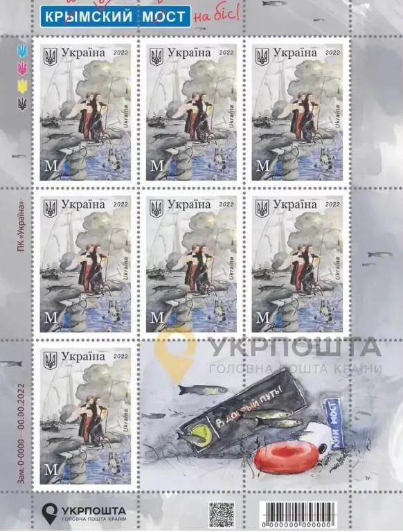

* toc
{:toc}

# 俄乌战争：苍天篇

## 库尔斯克战役（续）

https://www.zhihu.com/pin/1806680039632297984

第一周战况分析

https://zhuanlan.zhihu.com/p/714364160

简单聊聊机械化装备补充和库尔斯克攻势

https://zhuanlan.zhihu.com/p/714722158

乌克兰的库尔斯克2024行动有效削弱了俄罗斯近前线的地面补给线

https://zhuanlan.zhihu.com/p/714684490

由于乌克兰控制了库尔斯克南部，俄罗斯与白俄罗斯南部铁路中断

https://zhuanlan.zhihu.com/p/714967784

普京震怒 俄罗斯名将吉尔金成功预言乌克兰军队将入侵库尔斯克

https://zhuanlan.zhihu.com/p/714945151

关于此次乌军库尔斯克攻势的俘虏问题

https://zhuanlan.zhihu.com/p/715149484

乌克兰进攻俄罗斯的背后：保密、速度和电子干扰

https://news.ifeng.com/c/8cAX3swzkVL

俄乌两条战线各打各的，哪一方会先撑不住？

https://zhuanlan.zhihu.com/p/715979552

“我们将在库尔斯克遭遇最大的抵抗”——库尔斯克行动三名士兵的视角

https://zhuanlan.zhihu.com/p/715986438

俄乌边境史：17世纪的盖特曼·马泽帕购地之处如今战火纷飞

https://zhuanlan.zhihu.com/p/716329199

苏贾镇及库州西南地理态势分析

https://zhuanlan.zhihu.com/p/716800486

乌克兰在库尔斯克：战略胆识的一课

https://zhuanlan.zhihu.com/p/717597334

乌克兰将军的计划令俄罗斯人和他自己的部队感到惊讶

https://zhuanlan.zhihu.com/p/718496491

库尔斯克30天：1口浓痰，2道裂缝，3个纪录

https://news.ifeng.com/c/8cAX3swzkVL

俄乌两条战线各打各的，哪一方会先撑不住？

https://news.ifeng.com/c/8cL6qzZk6Qq

乌克兰攻入俄领土20天，俄军为什么不用核武器？

https://news.ifeng.com/c/8cQ9JCJSiDK

红线一退再退，为何俄罗斯不再提核武器？

https://zhuanlan.zhihu.com/p/827917874

库尔斯克60天：乌克兰的决绝

https://zhuanlan.zhihu.com/p/4961118472

库尔斯克90天：冬季前瞻

https://zhuanlan.zhihu.com/p/10857131591

库尔斯克120天：一颗新菜花

https://zhuanlan.zhihu.com/p/5809853628

库尔斯克之八：战损和价值重估

https://zhuanlan.zhihu.com/p/14396167432

五个月过去了，乌克兰在对行动的怀疑中紧紧抓住库尔斯克

https://www.zhihu.com/question/8680899864

2025年了，乌军在库尔斯克地区的形势如何？

https://www.zhihu.com/question/11291250076

目前库尔斯克的真实情况究竟如何？（2025.2）

https://zhuanlan.zhihu.com/p/22531885837

乌克兰库尔斯克行动：六个月评估

https://www.zhihu.com/answer/115314748389

库尔斯克战场局势（2025.3.4）

https://zhuanlan.zhihu.com/p/29059176153

俄罗斯战争博主们对通过煤气管道向苏贾运送100名士兵的灾难性失败感到愤怒（3月10日）

https://zhuanlan.zhihu.com/p/30326024857

库尔斯克最终章

https://zhuanlan.zhihu.com/p/30598823343

俄罗斯击溃乌克兰在库尔斯克的大胆军事行动

https://zhuanlan.zhihu.com/p/1937360238928966710

TCH采访西尔斯基

https://zhuanlan.zhihu.com/p/1936528227523862698

乌克兰人的库尔斯克攻势 其一：乌军行动准备

https://zhuanlan.zhihu.com/p/1936574028602143718

乌克兰人的库尔斯克攻势 其二：俄军防御部署与行动目标

https://zhuanlan.zhihu.com/p/1937201686042116453

乌克兰人的库尔斯克攻势 其三：作战行动第一章

https://zhuanlan.zhihu.com/p/1937897171291709457

乌克兰人的库尔斯克攻势 其四：作战行动第二章

https://www.zhihu.com/question/2032411805826463579

如何评价朝鲜库尔斯克纪念馆纪念显示朝鲜人民军在库尔斯克地区作战时至少死亡2300人？

## 克里米亚战役

本节主要包括克里米亚陆地战役、克里米亚大桥、空军/防空作战的内容。海军/特种作战相关的内容在《莫斯科号》一节。

---

**第一次炸桥（2022.10.8）**

“冯·菲尔森先生……我们失败了。”

冯·菲尔森上校：“可惜，真是一座好桥！”

（俄国工程师）艺高人胆大。中国人没那个艺术，也没那个胆子。

高情商：傻大黑粗，苏联遗风

低情商：人菜瘾大，不行强上

---

苏联是堆料，这是印度风。要真按傻大黑粗的苏联标准，这桥反倒不会断成那样了。

真按苏联的那种堆料，隔壁几个核电站就展示了什么叫苏联品质，炸弹都炸不动的东西你靠自爆卡车来？

1943年春天，希特勒要求开始建造一座横跨刻赤海峡的5公里大桥。我们在这里修建了索道，于1943年6月14日开通，每天运送数千吨货物。这足以满足第17军防御的需要。

在他们完成项目之前，苏联士兵占领了该地区。在德国人的基础上红军工兵建造了一座单轨铁路桥，但在1945年2月，浮冰撞到桥上，桥倒塌了。第一座刻赤桥持续了四个月。

事发前一天，普京迎来了他的70岁生日，这一行为也被戏称为给普京的“生日礼物”。

https://www.zhihu.com/answer/2706596260

刻赤大桥火车起火爆炸，为什么铁路桥没断，公路桥却断了一截？

http://www.xinhuanet.com/book/20211011/8ad6e1e3980c4a3e88e505443ee6ae72/c.html

两座桥的故事：全世界的“战地钟声”

https://zhuanlan.zhihu.com/p/571491896

真特种作战——切断刻赤海峡大桥

https://www.zhihu.com/question/558277344

克里米亚大桥的损坏程度中国工业能力多久能修好？对我国桥梁建设有哪些启示？

https://news.ifeng.com/c/8JyVWA1fc1p

车主现身！克里米亚大桥不是司机炸的？

https://www.163.com/dy/article/HJ7LVN26055269G4.html

乌克兰发行邮票庆祝克里米亚桥梁着火，网友：伤害不大侮辱性极强

https://zhuanlan.zhihu.com/p/1898473994828620809

乌克兰安全局如何炸毁克里米亚大桥

---

**第二次炸桥（2023.7.17）**

https://www.zhihu.com/question/612492873

乌克兰再度轰炸克里米亚大桥，破坏基础设施，两名俄罗斯游客丧生

---

2015年的时候，普京和贝卢斯科尼参观了位于克里米亚的马桑德拉酒庄，停在一瓶1775年Jeres de la Frontera葡萄酒前，意大利人问：这酒现在还能喝么？酒庄负责人随即打开了一瓶。然后原主人乌克兰人气的暴跳如雷，在国际上控诉意大利人腐败，（1775年乾隆四十年，美国刚独立，两瓶与类似的酒在2001年伦敦拍卖，其中一瓶拍出49,700美元）

---

2024年1月14日晚上，乌克兰军方宣称在亚速海上空击落了一架俄罗斯A-50远程雷达探测和控制飞机，并疑似击落了一架伊尔-22运输机。

2024年4月19日，乌克兰军方宣称用S-200击落了一架俄罗斯 图-22M3 远程战略轰炸机。

2022年5月，决定恢复S-200系统，并开始在战斗中使用它。首先，他们寻找在苏联时期和乌克兰独立后以前操作过S-200系统的军官。然后，他们找到了能够恢复综合体、发射器和导弹的工程师。

1月14日，爱国者炮台等待一架A-50，它驾驶一架Ilyushin Il-22指挥中心飞机穿越亚速海，在距离前线约150公里处巡逻。俄罗斯机组人员会认为自己远远超出了任何地面发射威胁的范围。在导弹击中之前，他们只有不到两分钟的时间来做出反应。A-50坠入海中，而Ilyushin号带着伤员返回基地。

他们使用打开雷达的S-300系统作为诱饵，将喷气式飞机引诱到爱国者系统的射程范围内。

俄罗斯喷气式飞机准备只与一个系统交战，无法应对导弹发射器的数量。

“他们很高兴飞出去摧毁S-300，然后爱国者出现了。在六架中，两架被S-300击落，四架被爱国者击落。”

https://www.zhihu.com/question/639561686

如何看待乌克兰击落俄罗斯A-50预警机?

https://www.zhihu.com/question/586911709

俄军预警机A50疑似遇袭，大家如何看待此事？

https://zhuanlan.zhihu.com/p/679613472

箭射巨鸟——乌克兰如何击落俄军预警机

https://www.zhihu.com/question/645630162

据最新消息俄罗斯空军损失了第二架A-50预警机，如何看待此事？

https://www.zhihu.com/question/653433713

俄国防部：俄军一架 图-22M3 远程战略轰炸机坠毁，哪些信息值得关注？

---

**第三次炸桥（2025.6.3）**

https://www.zhihu.com/question/1913317317586154975

乌克兰称袭击了克里米亚大桥，桥下结构严重受损

---

大俄不亏是旧日本帝国的精神继承者，开战借口战争逻辑全面抄袭也就算了，连帝国海军特色的老鼠快运都学会了。

不过就算是帝国海军，都还是会派点炮灰舰护航的。

你这嗯用民船往上顶，是不是太牲口了点？

鞑靼斯坦共和国现在天天都挨乌贼轰炸，每天防空警报都会响起。他妈妈是首府喀山一个幼儿园的保育员，天天都要带着孩子们钻防空洞。几岁的幼儿现在都知道听到防空警报就乖乖的跑防空洞，多的时候一天得跑好几次。

https://www.zhihu.com/question/2057880248071485004

如何看待乌克兰军方在亚速海对俄罗斯油轮开展的执法行动？

https://zhuanlan.zhihu.com/p/2059695628574372497

“亚速海战役”冲击全球海军

---

**第四次炸桥（2026.11.16~17）**

刻赤大桥能被精确打断，说明乌克兰“用人在回路末端TV制导巡航导弹”这种FP5奇葩思路, 掌握了低成本精确摧毁桥梁的办法。

经俄占领区，通过梅利托波尔再到克里米亚地峡的陆路补给通路。也有各种堵点，如数座大桥和浮桥。打击他们的难度远远比干掉刻赤大桥低。

而且这段因为离前线近，乌军之前甚至拿无人机往公路上扔地雷，一度炸到俄军给卡车司机40万卢布一程的买命钱才有人敢出车。

https://zhuanlan.zhihu.com/p/2106127864642982216

泽连斯基披露：“七阶段行动”后，克里米亚大桥整段坍塌——《基辅独立报》20261117
