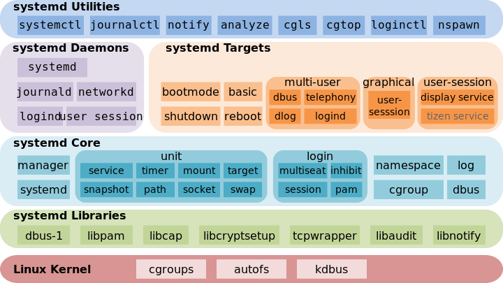
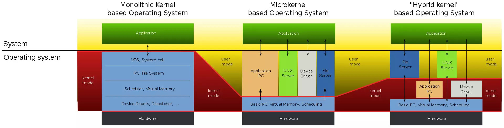
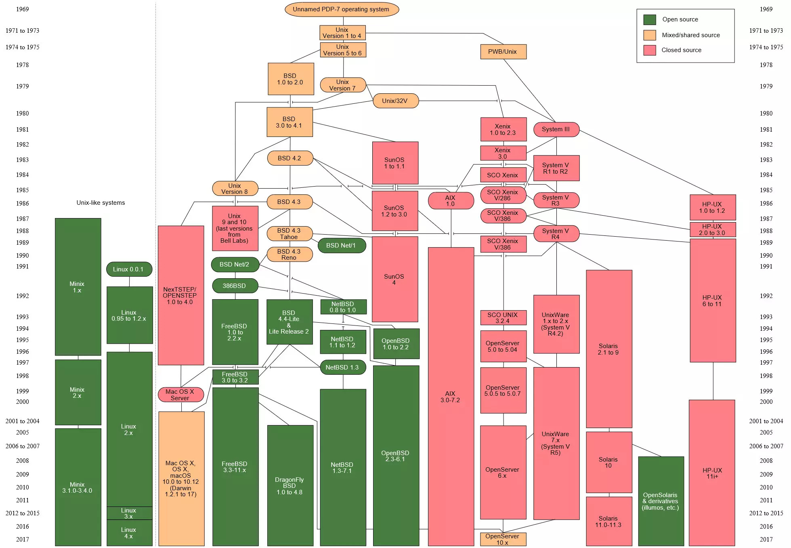

* toc
{:toc}

# tldr

tldr是一个采用示例说明的简化版的man。

官网：

http://tldr.sh/

该项目原生支持node.js，但也提供了其他多种语言的支持。

参考：

https://linuxtoy.org/archives/tldr.html

tldr: 简读Manpage

# Systemd

内核初始化的最后一步就是启动PID为1的init进程。这个进程是系统的第一个进程。它负责产生其他所有的用户进程。

init系统大体上的演进路线为sysvinit -> upstart -> systemd。

2010年，德国程序员Lennart Poettering（同时也是Avahi和PulseAudio的作者）发明了Systemd。

journalctl = dmesg + tail + grep + syslog的systemd版全家桶

http://www.ruanyifeng.com/blog/2016/03/systemd-tutorial-commands.html

Systemd入门教程：命令篇

http://www.ruanyifeng.com/blog/2016/03/systemd-tutorial-part-two.html

Systemd入门教程：实战篇

# Zero Page

https://www.cnblogs.com/linhaostudy/p/13647189.html

Linux内核虚拟内存管理之匿名映射缺页异常分析

https://zhuanlan.zhihu.com/p/336625055

Zero Fill On Demand

# 参考

https://www.kernel.org/doc/html/latest/

Linux官方文档

---

W.Richard Stevens著：

APUE: Advanced Programming in the UNIX Environment

UNP: UNIX Network Programming

---

https://mp.weixin.qq.com/s/n6D5_6K9TrnuXg3h6AiFNA

华为“鸿蒙”所涉及的微内核到底是什么？一文带你认识微内核

---

Ksplice是一个实验性的项目，用于无需重启机器的情况下更新Linux内核。SUSE和Redhat也先后推出了类似的项目。其中，前者为kGraft，后者是kpatch。后来这两者又被Linux内核吸收而成livepatch技术。

https://www.zhihu.com/question/406961061

为什么c语言不支持热更新？

---

http://toaruos.org/

一个日本人个人制作的OS

---

https://zhuanlan.zhihu.com/p/659446170

当代大学生Ubuntu系统个人电脑使用现状(资源分享帖)

---

生产环境在维护的时候重启之后所有数据几乎全部丢失。后来发现在投入生产环境这半年里，这台服务器一直运行在Ubuntu LiveCD环境下。

https://www.v2ex.com/t/974678

亲手造成的运维事故：在Live CD环境下部署并运行了8个月

---

https://www.linuxfromscratch.org/

教你一步一步的构建你自己的Linux发行版

---

现代Linux提供了基础设施可以让你用一个CPU核心来跑实时任务，这个核心不会受到Linux调度器的干扰，不会丢失时间片。哪怕这个Linux发行版并不是实时优化过的。

可以在U-boot中指定保留CPU3不参与正常Linux的运行：

`isolcpus=3 nohz_full=3 rcu_nocbs=3`

https://www.zhihu.com/question/31811422

四轴飞行器的飞控可以用linux系统的一个程序实现而不是整个板子就烧一个飞控程序吗？

---

PCB：Process‑Control‑Block

TCB：Thread Control‑Block

---

https://mp.weixin.qq.com/s/I7C7cXFgxO7RO0Wpjjj3xQ

一篇文章带你“重新认识”线程上下文切换怎么玩儿

https://www.cnblogs.com/liqiuhao/p/9450093.html

关于TOCTTOU攻击的简介

https://mp.weixin.qq.com/s/Y_GYtL9m3zmY-5VZMbCfWg

Linux中用户的简介与管理

https://linux.cn/article-8290-1.html

漫画赏析：Linux内核到底长啥样

https://mp.weixin.qq.com/s/IucIsbJPo4eUUopV8xNN9w

图解Linux程序的链接原理

https://mp.weixin.qq.com/s/zBtdhjAOjwcJbGluccwOlA

我和面试官之间关于操作系统的一场对弈！写了很久，希望对你有帮助！

https://mp.weixin.qq.com/s/3Pp7wkDO6Rnxb5aZP0sacw

一文了解操作系统I/O

https://mp.weixin.qq.com/s/xM8uvYbX6VY8MVZrYkvCUg

链接选项rpath的原理和应用

https://www.cnblogs.com/Malphite/p/10405465.html

Makefile中的-rpath/-rpath-link

https://juejin.im/post/5e8844996fb9a03c6675b9d6

我们按下电脑开机键的背后发生了什么？

https://mp.weixin.qq.com/s/DCqkgksOHa81EI-I0oaZvg

Linux下9种优秀的代码比对工具推荐

https://zhuanlan.zhihu.com/p/162366167

Linux下C++so热更新

https://mp.weixin.qq.com/s/rH7WqriomFTA55ecacV8Gw

键盘敲入A字母时，操作系统期间发生了什么...

https://mp.weixin.qq.com/s/vDlWCVK8knxPf5HoqmtZyQ

从创建进程到进入main函数，发生了什么？

https://mp.weixin.qq.com/s/7YVuouHAq2OfrowhoHVmnQ

Android对so体积优化的探索与实践

https://mp.weixin.qq.com/s/4ZdnacKuqkpWTso6P1Rmjg

如何调试多线程程序

https://mp.weixin.qq.com/s/8DNyicMcycUL3RRAiKAz8g

Linux进程必知必会

https://mp.weixin.qq.com/s/EkScI-WCdjLz1g2ec6nkhQ

理解格式化原理

https://mp.weixin.qq.com/s/Sqpp82FhZEC8HkeVHzk9QA

5万字、97张图总结操作系统核心知识点

https://mp.weixin.qq.com/s/SYlaIkuXBqFrbZ-gDMYqtA

高并发高性能服务器是如何实现的

https://mp.weixin.qq.com/s/73eaj0qvhUFWGbDA4H2MNQ

读取文件时，程序经历了什么？

https://mp.weixin.qq.com/s/Y8YZzkuzVr_ti6skHpd1NA

Linux网络包接收过程的监控与调优

https://mp.weixin.qq.com/s/4tAxQ0auQfv5x7Dh3B-85g

Linux内存管理

https://blog.csdn.net/orangeboyye/article/details/125998574

深入理解Linux内存管理

https://mp.weixin.qq.com/s/jDPxu6IVo3_VpK5l6_-jdQ

Linux系统内存知识

http://www.ruanyifeng.com/blog/2013/04/processes_and_threads.html

进程与线程的一个简单解释

https://www.cnblogs.com/biyeymyhjob/archive/2012/07/20/2601655.html

Linux写时拷贝技术(copy-on-write)

https://zhuanlan.zhihu.com/p/296207162

Linux I/O原理和Zero-copy技术全面揭秘

https://mp.weixin.qq.com/s/cudK2dhw4jNr7I34luVKVw

终于有人把零拷贝Zero-Copy讲懂了

https://mp.weixin.qq.com/s/-U7L8aXoaPXSwZshSpjQ2g

进程间通信

https://mp.weixin.qq.com/s/oKtu3AA9D3y--xMDQ8EARw

携程一次Dubbo连接超时问题的排查

https://mp.weixin.qq.com/s/4o_cSzWeJdLJMObJBhaZlw

计算机系统中的内存

https://www.jianshu.com/p/fad3339e3448

浅析Linux中的零拷贝技术

https://mp.weixin.qq.com/s/Q9BOA88Q6OBaDch1AiS9QA

原来8张图，就可以搞懂零拷贝了

https://mp.weixin.qq.com/s/6R8UcLLjm9gdWud-eNHztw

中断及其初始化

https://mp.weixin.qq.com/s/-hfI4GLkChRJQDqcLcvbGg

嵌入式C编程实现上下文的快速切换（cpost）

https://zhuanlan.zhihu.com/p/400200921

x86 Linux下实现10us误差的高精度延时

https://www.zhihu.com/question/496656138

为什么Windows文件设计成占用无法删除？

https://mp.weixin.qq.com/s/h4LwSRAsDgRqOq3mLt_SCw

浅谈mmap

https://mp.weixin.qq.com/s/djEPqxZSfMp13Uf_h6TSiA

认真分析mmap：是什么 为什么 怎么用

https://zhuanlan.zhihu.com/p/424240082

编译一个属于自己的最小Linux系统

https://www.zhihu.com/question/66902460

为什么Linux下要把创建进程分为fork()和exec()(一系列函数)两个函数来处理?

https://zhuanlan.zhihu.com/p/464204319

Linux网络子系统中DMA机制的实现

https://mp.weixin.qq.com/s/1JiXL1f3SSjsBojlJSNOpQ

Linux的启动流程

https://mp.weixin.qq.com/s/ZfprFQjVANuCE2N693gZBQ

用户空间和内核空间

https://mp.weixin.qq.com/s/P14VsWwSh9jiF-jBHSXXOw

申请内存时底层发生了什么？

https://mp.weixin.qq.com/s/OJHQZjxa6u8aA6jZyJnNPg

一文浅析内存管理机制

https://mp.weixin.qq.com/s/lAN0GKjkfkkWCurwRQb6DQ

如何排查句柄泄露问题

https://mp.weixin.qq.com/s/9UmzFxRdE4FFdrqEeBZtOQ

如何实现一个定时器？

https://mp.weixin.qq.com/s/zVi45pZka_kPpKIoNXNVBA

当初我要是这么学习“进程和线程”就好了

https://mp.weixin.qq.com/s/A8TnhOFLQOhEqphE760yvw

15个相见恨晚的Linux神器，你可能一个都没见过

https://mp.weixin.qq.com/s/v9XlJjIQkuVpSudhQIS70A

神秘！申请内存时底层发生了什么？

https://mp.weixin.qq.com/s/V-XT6QuDG522P0bP2e3ULg

咋办，死锁了

https://mp.weixin.qq.com/s/RHAoM8zhFvQl9R8V0ePxNQ

看腾讯这道多线程面试题

https://mp.weixin.qq.com/s/qWXcL90ZAkc7rrhsbuB_Bw

只有170字节，最小的64位Hello World程序这样写成

https://mp.weixin.qq.com/s/5iyWeSeDzuA2cY7YBMhk7w

MMU那些事儿

https://mp.weixin.qq.com/s/0OeeYUgBBVVMtxscvzgJHw

i++是线程安全的吗？

https://mp.weixin.qq.com/s/U0qr1oZYXBBmZnC5vsKYLQ

浅谈linux IO

https://mp.weixin.qq.com/s/3kgwoyYI90XHm1QPqFJAiQ

内存分页不就够了？为什么还要分段？

https://mp.weixin.qq.com/s/VSbzTh3xEbVdB4IgGJzQ3A

25张图，一万字，拆解Linux网络包发送过程

https://mp.weixin.qq.com/s/2dbr4-dxRCJ_SLCQnrt8ag

Linux内核调度器源码分析

https://yanqiyu.info/2021/06/21/huawei-v-qwr/

某不知名网友怒斥华为，究竟发生了什么

https://mp.weixin.qq.com/s/-8L5MFZrgmyatGgYaR1AEA

波兰极客用一张软盘运行Linux系统，用的还是最新内核！

http://www.cppblog.com/elva/archive/2008/09/10/61544.html

关于SIGPIPE导致的程序退出

https://www.zhihu.com/question/475730584

为什么linux在x86上不需要设备树，在aarch64上需要设备树？

https://zhuanlan.zhihu.com/p/641619701

发现谁用kill -9关闭程序就开除！

https://zhuanlan.zhihu.com/p/659658036

Linux6.1中为什么用Radix树替换位图（bitmap）来管理进程pid

https://zhuanlan.zhihu.com/p/662590546

深入理解Linux内核进程的创建、调度和终止

https://mp.weixin.qq.com/s/qwouMWc4CFtqG_jra4xbIg

IDT及中断处理的实现

https://mp.weixin.qq.com/s/pRsXWAv7wgYcN_jlzcA2YA

内存都没了，还能运行程序？

https://mp.weixin.qq.com/s/snQ3T86usv4rXz0MMQvFfQ

如何回答性能优化的问题，才能打动阿里面试官？

https://www.cnblogs.com/zhouyu629/p/3734494.html

一次心惊肉跳的服务器误删文件的恢复过程

https://mp.weixin.qq.com/s/IcEP-JGQbWA7s7yPdIC9vA

80%时间屏蔽了中断，实时性还有救么？

https://mp.weixin.qq.com/s/ejGjsGA1ijPP--j3BLcEFA

Linux并发与同步

https://mp.weixin.qq.com/s/CAPU8bjJWobQs6JHHMasvQ

Linux服务端最大并发数是多少？

https://mp.weixin.qq.com/s/bPqnaMqhi_4p1mwjmvyoIw

多图详解10大高性能开发核心技术

https://zhuanlan.zhihu.com/p/662681938

为什么linux不是实时操作系统？

https://zhuanlan.zhihu.com/p/669604193

Kernel怎么跳转到Android：linux与安卓的交界

https://mp.weixin.qq.com/s/iKfWSfzauzNjcAvXPNhq0Q

这些算法都不会还学什么操作系统
