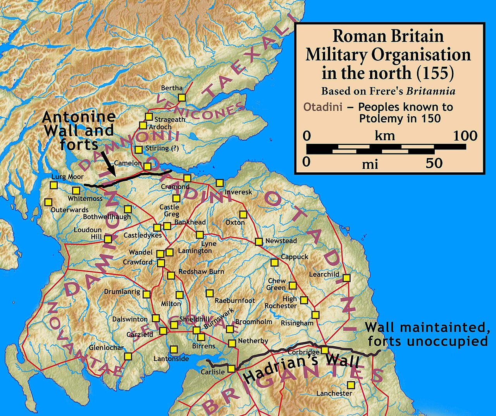
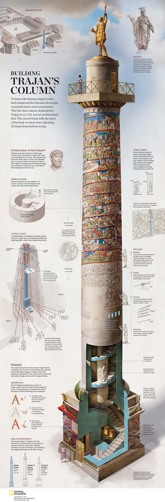

* toc
{:toc}

# 古罗马

卡西乌斯.狄奥在他的著作中声称埃拉伽巴路斯竟然还恬不知耻地在皇宫里当“X工作者”，随便什么人都可以玩弄他。据说小皇帝在行宫内有个专属的用来寻欢作乐的房间，他时不时安排“面试”，挑选合他胃口的情人；他经常赤身裸体躺在床上，等待过路的人和他行鱼水之欢，他一会儿当男一会儿当女，玩得不亦乐乎。最夸张的是，他曾要求御医帮他“改造”身体做个女性生殖器出来，更有甚者说他其实想变性成女人。

https://www.zhihu.com/question/482214431

如何评价罗马皇帝埃拉伽巴路斯?

---

在反复折腾了几回之后，我家狗的名字确定为：

Bingus Canis Flavius Labradosius Aelii filius Timidus Rumbruticus

狗族（Canis）的黄色（Flavius）拉布拉多家（Labradosius）的Bingo（Bingus），Aelius的儿子（Aelii filius），绰号“怂”（Timidus），Rumbrook狗公园的征服者（Rumbruticus）。

征服者称号暂时只有一个，以后可以继续加，等他多去几次，我就给他变成Rumbruticus Maximus。

https://www.zhihu.com/question/605055511

如何创造基于英语的伪法语 伪拉丁语?

---

---

所谓的“罗马式”敬礼，出自18到19世纪的画家雅克-路易大卫1784年的那副名画《荷拉斯兄弟之誓》，这才是所谓Roman Salute的来源，而根本不是古罗马人。

https://www.zhihu.com/answer/84392944201

如何看待美国民主党把马斯克的罗马式敬礼手式诬蔑成纳粹礼？

---

公元260年三世纪危机，除了罗马帝国中央承认的皇帝外，西部有高卢帝国的波斯图穆斯，东部有帕尔米拉帝国的奥登纳图斯和芝诺比娅，特里库斯在帝国东部建立割据势力后称帝。

---

庞培在非洲作战的时候，他的军团登陆之后不知道从哪传出来的消息，说非洲当地还埋着当年迦太基人留下的宝藏，导致庞培全军上下都忙着去挖宝藏。庞培那个时候倒也淡定，他没有严肃军纪，强行让士兵返回营地，而是就放任他们去挖。他不仅没管，而且还挨个拜访在挖宝的士兵，没完没了的嘲讽他们，直到好几天之后士兵们自己都觉得自己是一群傻X，主动来找庞培要求他带军出战。

---

Vindulus有个朋友Vedius Pollio留了一些东西在他那里。文度卢斯去世之后，他的继承人去检查他留下的东西，意外在波利奥的物品中发现了五个已婚的罗马贵族女性的胸像。于是乎，关于这五个雕像的意义就有好事儿的人开始分析，最合理的解释就是某种波利奥的怪癖，跟他有过不可描述关系的女性他都整个雕像，作为某种“征服纪念”。

---

苏拉第二次进军罗马时，花了一年多时间才攻下，在最终的科林门战役中也只是险胜——此时他的进军已经算不上突袭，所以罗马有充分时间做准备。

---

赛多留从一开始就很清楚的认识到，他在西班牙拉起来的队伍，哪怕是按照罗马人的方式组织和训练的，都无论如何没有办法跟罗马真正的军团部队相比。

赛多留亲自指挥的战役里，苏克罗战役最有代表性。赛多留一开始留在自己的右翼对位庞培的副将阿弗拉尼乌斯的左翼，打得顺风顺水。结果他自己的左翼被庞培指挥的罗马右翼打崩，赛多留一看不好，立马赶到左翼增援，他一到，他的山寨军团立马暴起，一波打崩了庞培的老兵，打得庞培差点被俘。但是同时，自己的右翼不出意外的被阿弗拉尼乌斯打崩，然后赛多留又反手击溃了阿弗拉尼乌斯。结果，梅特卢斯关键时刻赶到，救了庞培一命。因此赛多留留下了那句：“如果那个老女人没来，我现在已经收掉他（庞培），让他卷铺盖滚回罗马了！”

https://www.zhihu.com/question/1911542496091156756

历史上有哪些指挥官很优秀但是由于士兵水平差而输掉的战役或战争呢？

---

---

罗马男性标准三段命名体系：

- Praenomen（首名 / 私名）：专属个人名字，比如‑Lucius、Gaius、Marcus，家里长辈日常称呼；
- Nomen（族名）：氏族姓氏，如Julius、Cornelius；
- Cognomen（家支名）：分支绰号。

例：Gaius Julius Caesar。

共和时代早期，贵族女子不会分配独立praenomen。女性只用父亲的Nomen的阴性形式当作自己的名字：父亲Julius → 女儿Julia；

家里多位姐妹不会给各自首名，依靠序数称呼：Prima（老大）、Secunda（老二）、Tertia（老三），比如Julia Secunda只是 “尤利家第二个女儿”，并不是她专属的独立首名。

---

https://www.bilibili.com/read/cv5699454/

历代罗马皇帝列表

http://www.ict.griffith.edu.au/wiseman/Roman/EmpiresStrikeBack.html

476年以后罗马帝国鼎盛期疆域所出现过的各大强权

https://www.zhihu.com/question/317408964

如何过得像个东罗马贵族?

https://www.163.com/dy/article/G2TB7GMH0543HIJQ.html

辟谣：罗马士兵工资发了等于没发？太低级的谣言

https://www.zhihu.com/question/505031003

罗马帝国最大领土是怎么样的？

https://www.zhihu.com/question/423981182

古罗马历史上哪些军团可以称为王牌？

https://zhuanlan.zhihu.com/p/74453316

古罗马斗兽场完全八卦手册（上）

https://zhuanlan.zhihu.com/p/74610242

古罗马斗兽场完全八卦手册（下）

https://zhuanlan.zhihu.com/p/456545071

钱币上的罗马（上）

https://zhuanlan.zhihu.com/p/461540485

钱币上的罗马（下）

https://www.zhihu.com/question/266774805

如何评价罗马皇帝巴西尔二世？

https://zhuanlan.zhihu.com/p/24781429

帝国贵族服饰变迁（6世纪-11世纪早期）

https://www.zhihu.com/question/593413129

罗马多神教的战神和希腊多神教的战神有什么区别？

https://www.zhihu.com/question/601392171

古罗马采矿业是怎样的？罗马帝国境内有几处较大的矿场？

https://www.zhihu.com/question/426552826

罗马各个行省对其分别有哪些战略意义？

https://www.zhihu.com/question/612045704

古罗马的营业税是怎么收取的？

https://www.zhihu.com/question/612083928

东周的洛邑和同时期的罗马城哪个更繁华?

https://www.zhihu.com/question/378885345

罗马最终为什么没能征服日耳曼人？

https://www.zhihu.com/question/509036925

雷必达在帝国成立中的作用？

https://www.zhihu.com/question/68104918

为什么黑森林惨败奥古斯都会那么失态？
