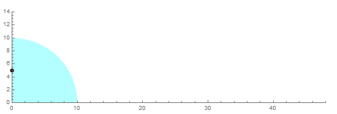

* toc
{:toc}

# 哥德巴赫猜想

筛选上限z越逼近$$N^{1/2}$$，误差越大，并超过主项，导致筛法失效。

陈景润把筛选上限降到$$z = N^{1/10}$$，只筛掉极小的素数。

这时候，留在筛子里的数$$N-p$$可能会混入一些合数。p为上述筛选上限内的素数集合。也就是陈氏定理（1+2）中的1。

为了把合数剔除掉，陈景润设计了一个加权计数函数W：

$$W = \sum_{x \in A, \gcd(x, P(z))=1} \left( 1 - \frac{1}{2} \lambda_1(x) - \frac{1}{2} \lambda_2(x) \right)$$

这里的$$\lambda_1(x)$$和$$\lambda_2(x)$$是根据x的素因子大小精心设计的惩罚项：

- 如果x是一个纯素数（即“1”），权重计算出来是+1（正贡献）；
- 如果x是两个素数的乘积（即“2”），权重计算出来也是大于0的正数（正贡献）；
- 如果x是三个或更多素数的乘积（比如“3”或“4”或更多），权重计算出来就会变成负数（负贡献，直接在总和里被扣除）！

陈景润通过极其复杂的解析数论技巧（结合了大筛法不等式），最终算出了这个总权重W的下界大于0，这就说明：集合中必须存在正贡献的元素！

也就是说，$$N-p$$要么是一个素数，要么是两个素数的乘积。

当你试图把“2个素数乘积”也作为合数扣除掉时，加权公式里的正负项平衡被彻底破坏了。

因为**奇偶性难题**的存在，筛法用的刘维尔函数在应对“1个素因子”和“2个素因子”时，在筛法不等式里的上下界系数完全是对称的。

一旦算不出$$W>0$$，整个逻辑链条就断了，就无法证明筛子里到底有没有剩下素数。这就是为什么“1+2”已经是筛法的极限的原因。

---

圆法这套工具，是哈代（Hardy）和李特尔伍德（Littlewood）在20世纪初发明出来的，后来拉马努金和维诺格拉多夫也对它做出了贡献。

如果说筛法是在拿筛子滤数字，那圆法就是在做信号分析。它的核心思想是，把“寻找两个素数相加等于偶数N”这个问题，转换成在复平面单位圆上算一个波形函数的积分。

1937年，苏联数学家维诺格拉多夫证明了“奇哥德巴赫猜想”（任何大奇数都能写成三个素数之和，即“1+1+1”）。

圆法的关键在于必须要证明：劣弧上的噪声积分，绝对值远远小于主弧上的信号。

如果不出现全新的解析手段来把劣弧上的精确度提高几个数量级，圆法在“1+1”面前就永远无能为力。

素数是用乘法定义的（除了1和自己，不能被其他数整除）。

但“1+1”问的是加法（两个素数拼出一个偶数）。

无论是黎曼函数，还是狄利克雷L-函数，它们本质上都是通过解析延拓和复分析去挖掘素数的乘法对称性。

黎曼猜想只够保证素数的“乘法分布”很美，但想拿它去攻克哥德巴赫猜想的“双素数加法交叉”，还是不够。

---

历史上有很多数论硬骨头，最后都不是被数论本身的工具搞定的，而是被隔壁代数几何搞定的。最典型的例子就是张圣容（Audrey Terras，出生于陕西西安的女数学家）和德利涅（Pierre Deligne）利用代数几何解决韦伊猜想，或者怀尔斯（Andrew Wiles）用模曲线攻克费马大定理。

张圣容与同届（1970）的李文卿、金芳蓉、吴征眉合称台大数学系四朵金花。再加上稍后的滕楚莲、萧美琪有台大数学系六朵金花之称。

哥德巴赫猜想本质上是个丢番图方程问题：

$$x + y = N \quad (x, y \text{ 均为素数})$$

现在也有数学家尝试把素数构成的代数簇，映射到高维模空间或者算术几何曲线上去。通过研究这些几何曲面上的算术交理论（Arithmetic Intersection Theory），或许根本不需要去算具体的素数有多少个，而是从空间拓扑性质上证明：代表偶数拆分的几何交点，在N>2时数量绝对不可能为零。

这种方法完全绕开了筛法的误差和圆法的劣弧，直接从代数结构上降维打击。

当然，这条路目前最飘渺，连具体的映射框架都还在摸索阶段。

---

https://www.zhihu.com/answer/2084755661464904875

为什么哥德巴赫猜想难以用传统方法证明？

https://mp.weixin.qq.com/s/68K3L_pD7xfobr_jA1QgWA

陈景润究竟为证明哥德巴赫猜想做出了哪些贡献？

# 肺炎版《黄冈密卷》

问题由来：

https://mp.weixin.qq.com/s/dR7fg6PTCVAnezlW6gTY2w

新冠病毒最“强”管控，《黄冈密卷》数学题到底有多难

---

1.设$$\sqrt{3+\sqrt{2}+\sqrt{3}+\sqrt{6}}=\sqrt{x}+\sqrt{y}+\sqrt{z}$$，且x、y、z为有理数，则$$xyz$$=?

解：

$$3+\sqrt{2}+\sqrt{3}+\sqrt{6} = x+y+z+2\sqrt{xy}+2\sqrt{xz}+2\sqrt{yz}$$

由x、y、z为有理数可得：

$$4xy=2, 4xz=3, 4yz=6$$

由于x、y、z在原式中是对称的，所以上式中选择哪个等于2、3、6，都是无所谓的。

三式相乘可得：

$$4^3 \cdot (xyz)^2 = 36$$

$$(xyz)^2 = 9/16$$

$$xyz = 3/4$$

---

2.设二次函数$$f(x)=ax^2+ax+1$$的图像开口向下，且满足$$f(f(1))=f(3)$$，则$$2a=?$$

解：

令$$y=2a$$，则$$f(1)=2a+1=y+1$$

$$f(f(1))=f(y+1)=f(3)$$

$$a(y+1)^2+a(y+1)+1=9a+3a+1$$

$$(y+1)^2+(y+1)=12$$

$$y^2+3y-10=0$$

$$(y+5)(y-2)=0$$

因为图像开口向下，所以$$2a=-5$$。

---

最近，黄冈再次因数学题而火爆网络。

以下是2020黄冈中考数学第16题：

求上图扇形一边的中点P，在扇形滚动一周的过程中，所经历的路径的长度。

显然，第1，3，4段都是圆弧，难就难在第2段（绿色）了。这条曲线可不是那么好求的，普通的本科高数都搞不定它。必须出动椭圆积分才行。

https://www.zhihu.com/question/408523403

如何解答2020黄冈中考数学第16题？

>小学能接受1/3这种无限循环小数，初中能接受根号，高中能接受ln(2)，那大学的精确解为什么不能接受椭圆函数。

https://mathworld.wolfram.com/EllipticIntegraloftheSecondKind.html

Elliptic Integral of the Second Kind

这里有个上面动图的GeoGebra版本：

https://github.com/antkillerfarm/antkillerfarm_crazy/blob/master/geogebra/huanggang.ggb

《椭圆函数及其应用》 高本庆 著

---

https://mp.weixin.qq.com/s/FdHstCxJqQ4wYXSRDyqm5A

不敢相信！这份民国时期大学入学考试试卷，竟让170位院士头疼！

# AI数学

用Claude解决问题的levent alpoge是那年math 55成绩第二的学生。而他在帖子里提到的akhil是akhil mathew，是那年唯二直接跳过math 55上研究生课程的学生，现在是芝加哥大学最年轻的正教授之一，研究方向正是代数几何。

https://www.zhihu.com/question/2062518030224061737

如何评价代数几何著名猜想“雅可比猜想”被AI证伪？如此简洁、可独立验证的数学发现意味着什么？

https://www.zhihu.com/question/2040738759281473391

如何评价OpenAI称推翻困扰数学界近80年的“平面单位距离猜想”？这一结果的可信度如何？

https://zhuanlan.zhihu.com/p/2071261191620636735

困扰数学圈22年的难题（Crouzeix猜想），居然被协和实习医生解决了？

https://www.zhihu.com/question/2071680380755785039

怎么看森多夫猜想（Sendov's Conjecture）已被AI、Lech Mazur、陶哲轩攻破？

https://www.zhihu.com/question/2098291700204622696

如何看待ETH（指数时间猜想）猜想被OpenAI证伪？

https://www.zhihu.com/question/2093787788684390525

OpenAl证明的朗道-西格尔零点问题被数学家重新解释，是否意味着这个问题被解决？

---

学军消灭定理降临现实：

- 数学定理变成货架上的商品，花token就可以买到，价格不低但总会降低。
- 数学定理不再代表人类心智的荣耀（无论这是纯手工证明、ai辅助证明还是纯ai证明），对人类的意义归零。
- 如无现实应用，这个几乎无人能懂、无人能用的定理本身的价值趋近于零。
- 没人会为没有价值的东西付费。

真实的物理世界充满了各种安全阀。当局部出现数学上所谓奇点时，流体本身可以发热，可以膨胀，可以相变，甚至可以电离，这些物理现象本身就是一种正则化。更不用说当尺度小于分子自由程时，它已经从连续介质力学变成了分子动力学问题。N-S方程只是一个在宏观尺度还不错的理想模型罢了。

https://www.zhihu.com/question/2080887293624304807

OpenAI宣布攻克了N-S equations这一千禧年问题，这意味着什么？
