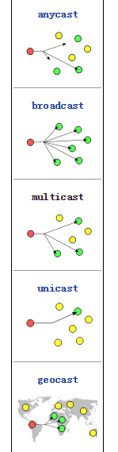

* toc
{:toc}

# IEEE 802

IEEE 802是一系列关于局域网和城域网的标准。

其中，最重要的有：

802.1 802系列协议的网络层管理。

802.3 Ethernet

802.11 Wi-Fi

802.15.1 Bluetooth

802.15.4 Zigbee

802.16 WiMax

http://www.ieee802.org/

可以在这个网址下载相关的标准文件。

## 无线网状网

Wireless mesh network（WMN），也叫wireless ad hoc network。

Ad Hoc源自于拉丁语，意思是“for this”引申为“for this purpose only”，即“为某种目的设置的，特别的”意思，即Ad hoc网络是一种有特殊用途的网络。IEEE802.11标准委员会采用了“Ad hoc网络”一词来描述这种特殊的自组织对等式多跳移动通信网络

它具有以下特点：

### 无中心

Ad hoc网络没有严格的控制中心。所有结点的地位平等，即是一个对等式网络。结点可以随时加入和离开网络。任何结点的故障不会影响整个网络的运行，具有很强的抗毁性。

### 自组织

网络的布设或展开无需依赖于任何预设的网络设施。结点通过分层协议和分布式算法协调各自的行为，结点开机后就可以快速、自动地组成一个独立的网络。

### 多跳路由

当结点要与其覆盖范围之外的结点进行通信时，需要中间结点的多跳转发。与固定网络的多跳不同，Ad hoc网络中的多跳路由是由普通的网络结点完成的，而不是由专用的路由设备（如路由器）完成的。

### 动态拓扑

Ad hoc网络是一个动态的网络。网络结点可以随处移动，也可以随时开机和关机，这些都会使网络的拓扑结构随时发生变化。　这些特点使得Ad hoc网络在体系结构、网络组织、协议设计等方面都与普通的蜂窝移动通信网络和固定通信网络有着显著的区别。

无线网状网可以基于802.11、802.15或802.16。具体到802.11就是Wi-Fi Mash。

## Wi-Fi Mash

和普通Wi-Fi相比，Wi-Fi Mash主要增加了路由协议。而这一块目前尚无标准，有70多个相互竞争的路由协议。其中主要有：

AODV (Ad hoc On-Demand Distance Vector)

B.A.T.M.A.N. (Better Approach To Mobile Adhoc Networking)

HWMP (Hybrid Wireless Mesh Protocol)

OLSR (Optimized Link State Routing protocol)

IEEE为了统一标准，提出了802.11s。目前该标准默认使用HWMP。

## 消息发送的类型

## 参考

https://mp.weixin.qq.com/s/GgwehPL4r-Y1pEd2k60Y_Q

一文看懂蓝牙Mesh技术

https://mp.weixin.qq.com/s/Mvq9UNEnHoUbmxocb-rqmQ

LPWAN、LoRa、LoRaWAN的区别与联系

https://mp.weixin.qq.com/s/ddOTd5ljC2I9IOadBbjOIA

大话Wi-Fi20年

https://www.zhihu.com/question/20890194

大型发布会现场的Wi-Fi应该如何搭建？

---

802.11b — Wifi 1 (1999)

802.11a — Wifi 2 (1999)

802.11g — Wifi 3 (2003)

802.11n — Wifi 4 (2009)

802.11ac — Wifi 5 (2014)

802.11ax — Wifi 6 (2018)

https://mp.weixin.qq.com/s/5MjByZWThzQ4MSWRoIS1HQ

为了Wi-Fi 6，华为和小米争个啥？

https://mp.weixin.qq.com/s/ZHgG3NJ3oMxmz8M6VDImXg

什么是WiFi 6E？它与WiFi 6有何不同？

https://mp.weixin.qq.com/s/2Jo1dGu7_Lu3yC5Xwe-IMg

漫画图解UWB的发展之路

https://mp.weixin.qq.com/s/D_1nn0702Z1y7rKOzegs5g

Wi-Fi简史
