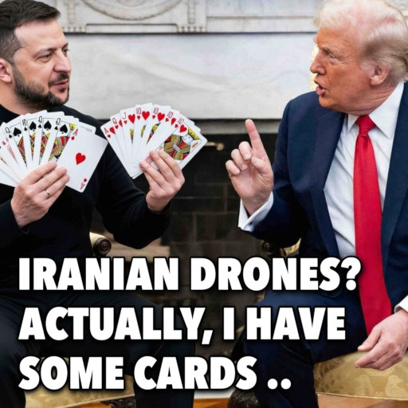
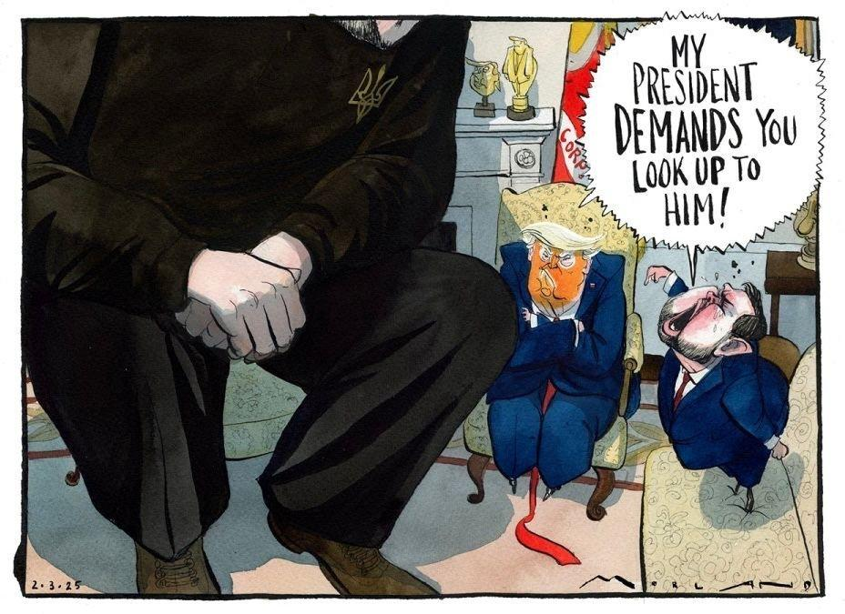

* toc
{:toc}

# 俄乌战争：疾风篇

## 泽连斯基语录（续）

乌克兰想要什么？和平？是的。不惜任何代价？不。我们希望战争结束——而不是乌克兰的终结。我们疲惫吗？极度疲惫。这意味着我们准备好投降了吗？这样想的人大错特错。显然，经过这么多年，他们仍然不明白乌克兰人是谁。这是一个在全面战争中坚守了1407天的民族。请体会这个数字。这比二战期间纳粹对我们许多城市的占领时间还要长。

波兰、土耳其、芬兰、叙利亚、格鲁吉亚、阿布哈兹、奥塞梯、车臣——这个名单可以无限延长，因为俄罗斯几乎全部的领土都是通过战争拼凑起来的。

"从顿巴斯撤军，一切就会结束。"——这就是将欺骗从俄语翻译成乌克兰语、英语、德语、法语，事实上翻译成世界上任何语言时的样子。

乌克兰不需要明斯克式的精心设计的陷阱。在软弱协议上签字只会助长战争。我的签名将只落在强有力的协议之下。

如果乌克兰倒下，接下来的问题将是："为何支持波兰？"、"谁会为波罗的海国家而战？"以及"北约没有乌克兰还有什么意义？"

伊朗目前发生的一切，包括大规模抗议乃至起义，都清楚地表明：俄罗斯的处境不会好转。全世界的普通民众都真心希望伊朗人民最终能够摆脱这个政权的统治。

俄罗斯对乌克兰的大规模战争已经持续了与纳粹德国对抗苏联战争一样长的时间，今天是俄罗斯对乌克兰战争的第1418天。——重复了法西斯主义，重复了20世纪几乎所有最糟糕的事情。

但俄罗斯人仍在试图占领和近四年前一样的顿巴斯地区，他们想再次谎称已占领库皮扬斯克，在扎波罗热地区的战场上无休止地牺牲，并仍在与团结的乌克兰作战。

而伊朗在这场流血事件之后会变成什么样子？如果政权存活下来，它会向所有恶霸发出明确信号：杀够多人，你就能继续掌权。欧洲有谁需要这个信息成为现实？

为什么特朗普总统可以阻止影子船队的油轮并夺取石油，而欧洲却不能？俄罗斯石油正沿着欧洲海岸运输。

如果你派30到40名士兵去格陵兰，那是为了什么？它传递了什么信息？对普京有什么信息？

你要么宣称欧洲基地将保护该地区免受俄罗斯等国的威胁，并建立这些基地，要么你就有可能因为30到40名士兵无法保护任何东西而不被认真对待。

如果俄罗斯军舰能自由航行格陵兰，乌克兰可以提供帮助，我们拥有专业知识和武器，确保这些舰船一艘都不存在。它们在格陵兰附近可能会沉没，就像在克里米亚附近一样。

但当你拒绝帮助一个为自由而战的人民时，后果就会重演，而且总是负面的。2020年的白俄罗斯就是一个例子。

没有人帮助他们的人民。现在，俄罗斯的“榛树”导弹部署在白俄罗斯，几乎能到达大多数欧洲首都的射程。如果白俄罗斯人民在2020年获胜，这种情况就不会发生。

特朗普想要妥协。我们做出了许多妥协。普京和他的同伙没有被关进监狱——这已经是世界做出的最大妥协。我们接受了停火协议，但普京拒绝了。

美国人和俄罗斯人都说，如果你们想让战争明天就结束，那就从顿巴斯撤军。但是我们不准备做出任何损害领土完整的妥协；我们不会不战而降，将顿巴斯和扎波罗热拱手让给俄罗斯人。 

特朗普一直试图将他未能通过军事手段夺取的领土拱手让给普京，一方面向受害者施压，另一方面却奖励帝国主义侵略者。

没有人希望在战时举行选举。每个人都害怕选举带来的灾难性后果。俄罗斯人坚持要举行选举，仅仅是因为他们想换掉我。

普京一方面向特朗普政府承诺有兴趣结束战争，但另一方面却在私下里向将军们下达了“必须在2月24日前占领更多顿巴斯领土”的死命令。普京根本不需要和平，他只需要乌克兰的投降和美国的撤出。

当政客们在舒适的办公室里争论300平方公里土地是否值得拯救时，沙赫德无人机和俄罗斯的导弹每一秒都在毁灭我们的电厂。

普京不像素人那样生活。他不逛街。你不会在咖啡馆见到他。他的孙辈不去家乡普通的幼儿园。他无法想象没有权力或失去权力后的生活。正常的事物他不感兴趣。普京与彼得大帝和凯瑟琳女皇“商讨”领土扩张的次数，比与任何活人商讨现实生活的次数还要多。你能想象没有战争的普京吗？

现在越来越多来自不同国家的卸任官员说，他们曾对这场战争发出过“预警”，说他们预料到了入侵会发生。他们“记得”自己说过什么——而且在大多数情况下，他们极大地美化了自己的故事。

但他们中没有一个人能说出，他们到底做了什么来阻止入侵。所有这些故事都只关乎一件事——推卸责任。

看看现在，我们伟大的小伙子、运动员弗拉迪斯拉夫·赫拉斯凯维奇，仅仅因为打算戴一顶印有在战争中丧生的运动员面孔的头盔，就被取消了奥运参赛资格。他仅仅因为一个“意图”就被取消资格。而当我们在2021年清楚地看到普京的意图，并请求预防性制裁以阻止入侵时，我们被告知——必须先有罪行，然后才能有惩罚。

请记住，在这4年里，俄罗斯是什么时候开始最严肃地对待外交的？是当我们对俄罗斯炼油厂的深度打击开始奏效时——以及当所有人开始讨论“战斧”巡航导弹时。这恰恰展示了如何应对俄罗斯，以及俄罗斯究竟能听懂什么。它能听懂力量。我们越强大，和平就越现实。

普京希望重演“慕尼黑”。不是2007年的慕尼黑——当时他只是在口头上谈论分裂欧洲；而是1938年的慕尼黑——当时“前任普京”在现实中开始了对欧洲的分裂。如果相信现在可以通过分割乌克兰来可靠地结束战争，那将是一种幻想——就像当年相信牺牲捷克斯洛伐克能让欧洲免于更大的战争一样。

所有的美国专家，无论是否熟悉内情，大家都明白，在应对大规模沙赫德无人机袭击方面，如今确实只有乌克兰的经验能提供帮助。甚至那些在各处“悄悄”购买（拦截无人机）的国家——我这么说并没有指责的意思——但他们确实在某些地方购买并获得了乌克兰的拦截无人机，而他们现在已经发现，如果没有我们的军队、我们的操作员、我们的软件、雷达场以及许多细微的技术差异，没有这一切，这些拦截器根本无法工作。

现在，绝大多数乌克兰人积极看待我们的远程无人机造访了你在圣彼得堡举办的论坛开幕式，飞行距离超过1000公里。正如您非常清楚的那样，这个距离并非我们能力的极限。

许多人都不相信乌克兰能够坚持这么久。你不相信。而那些给你建议的人也不相信。这是一个错误。

你没有预料到乌克兰会展开全面抵抗，你也没有预见到事情会发展到这一步。然而我们都来到了这里——在这场全面战争的第五个年头。

奥尔班的例子表明，那些选择在俄罗斯对我们的战争中提供帮助的人将以耻辱告终。

我们将战争带到了你们的领土上，如果没有朝鲜的帮助，你们将无法应对。你是首位向平壤求助的俄罗斯统治者。

而今天，你完全依赖中国——这也是俄罗斯历史上第一次。

你相信乌克兰人没有力量自卫。然而今天，我们的人民正在帮助我们在中东和海湾地区的伙伴建立自己的防御。

你期待乌克兰内部出现动荡。相反，是你自己的军事部队对你发动了兵变。6月23日将迎来这一事件的又一个周年纪念日，沉默无法从历史中抹去这一事实。

这座我们的国家圣地，连同圣索菲亚大教堂、切尔尼戈夫的主显圣容大教堂以及其他许多见证基辅罗斯千年历史的遗迹，所有这些共同最终证实了一个事实：乌克兰人在这片土地上的根基深厚、牢固且属于我们自己。

PS：基辅佩切尔斯克修道院，初建于1051年，院内有圣母升天大教堂。2026.6.15 俄军空袭圣母升天大教堂。

从今以后，在这里，在基辅佩切尔斯克修道院，将堂堂正正地矗立着伟大乌克兰人、修道院庇护者伊万·马泽帕的半身像。

几个世纪以来，俄罗斯玷污他的名字，企图让乌克兰人透过别人的眼睛看自己的历史，说服我们的人民相信马泽帕是叛徒。这是谎言，而这个谎言已经失败。永远失败。

只需说一个事实，自全面战争开始以来，俄罗斯军队已经被下达了15次攻占我们顿涅茨克地区的期限。如果俄罗斯不结束这场战争，那么他们将不得不再次推迟这个期限。如果普京想再派一百万他的士兵继续来撞这堵墙，那么那些尚未被动员入伍、正在排队为汽油争吵的一百万俄罗斯人，就该想想接下来等待他们的将会是什么。

长久以来俄罗斯始终坚信，广袤领土就是它的护身符。俄方笃定没有人可以抵达西伯利亚腹地，于是在这里修建炼油厂、军工工厂，生产燃油与弹药，支撑军队对乌克兰城市发起无休止袭击。俄罗斯领导层沉浸在一种错觉之中：战略纵深永远安全，战火永远烧不到俄罗斯本土。

但是乌克兰打破了幻想。就在昨天，我们的远程无人机穿越数千公里路程，突破俄军层层防空拦截，击中西伯利亚鄂木斯克大型炼油厂。
